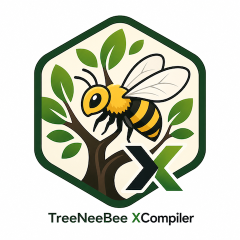
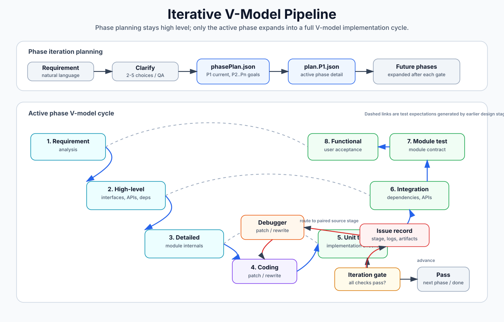
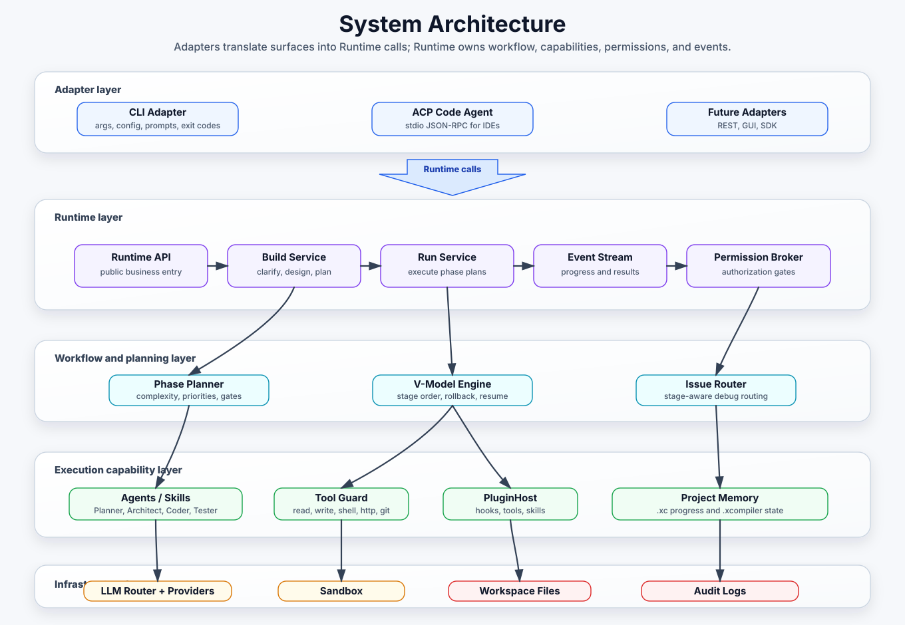

<p align="center">
  
</p>

<h1 align="center">XCompiler</h1>

<p align="center">
  <strong>AI Software Factory Runtime</strong>
</p>

> Turn natural-language requirements into runnable, tested Python or TypeScript projects through an iterative V-model workflow.

<p align="center">
  <a href="https://www.npmjs.com/package/@xcompiler/cli"></a>
  <a href="LICENSE"></a>
  <a href="https://nodejs.org">= 24" /></a>
</p>

Languages: **EN** (default) · [简体中文](README.CN.md)

---

## What XCompiler Does

XCompiler is a reusable AI software factory runtime. It compiles a product request into an executable engineering plan, then runs that plan with sandboxed agents, guarded tools, tests, debug loops, audit logs, and resumable project state.

| Command | Role | Input | Output |
|---|---|---|---|
| `xcompiler build` | Compile requirements into a `phasePlan.json` plus the current phase plan, such as `plan.P1.json` | Requirement text (`-i req.md`, `-t topic.md`, or interactive input) | `topic.md`, `phasePlan.json`, `plan.P1.json`, `plan.md`, `<name>.xc` |
| `xcompiler run` | Execute the current phase through the V-model workflow | `phasePlan.json` | Runnable project, tests, docs, audit trail, updated progress |
| `xcompiler load` | Resume from a project file | `<name>.xc` | Continue the saved phase/task state |
| `xcompiler append` / `xcompiler evolve` | Add new requirements to an existing project | Existing workspace/project file plus new requirement | Incremental plan and implementation |
| `xcompiler acp` | Run as an ACP code-agent adapter | stdio JSON-RPC from an IDE/editor | Runtime-backed code-agent events and results |

The current architecture treats **Runtime as the only business entry point**. CLI and ACP are adapters: they parse input, load config, render output, and listen to Runtime events, while Runtime owns build/run/workflow/agent/tool/plugin/memory behavior.

---

## Iterative V-Model Pipeline

XCompiler combines a phase iteration model with the V-model. The planner first creates a high-level `phasePlan.json`, then expands only the active phase into a concrete `plan.P<N>.json`. Each current phase runs a full V-model cycle. After its iteration gate and project audit pass, it becomes `complete`; XCompiler activates the first dependency-ready phase and materializes only that phase's plan for the next run.

<p align="center">
  
</p>

V-model behavior:

- Each implementation Phase owns exactly eight canonical Steps: `REQUIREMENT_ANALYSIS`, `HIGH_LEVEL_DESIGN`, `DETAILED_DESIGN`, `CODE`, `UNIT_TEST`, `INTEGRATION_TEST`, `MODULE_TEST`, and `FUNCTIONAL_TEST`.
- Planner JSON is an immutable execution specification. Runtime compiles it into globally identified domain objects; only those objects own lifecycle state. Every one of them carries the same envelope — a UUIDv7 `id`, `objectType`, `projectId`, `revision`, and timestamps — and is committed through the object registry: Project, ProjectPlan/PhasePlan, Phase, Step, Ticket, ActorRegistration, TicketAssignment, TicketTraceEvent, ProjectManagementPlan, Decision, Risk, InteractionRequest, KPI, QualityAssessment, Changelist, Checkpoint, Deliverable, Report, Log, AuditEvent, and DomainEvent.
- `REQUIREMENT_ANALYSIS`, `HIGH_LEVEL_DESIGN`, `DETAILED_DESIGN`, and `CODE` generate the paired functional, module, integration, and unit baseline test plans/cases.
- `HIGH_LEVEL_DESIGN` defines system-level interfaces, external APIs, third-party libraries, and dependencies.
- `DETAILED_DESIGN` defines internal module structure and implementation details.
- S1-S4 author their deliverables and the paired baseline suites. S1-S3 validate their own deliverables and baseline assets. By default the paired verification Step runs the executable baseline, including after an upstream correction. An explicit required gate still applies. S4 also runs its unit baseline.
- S5-S8 independently inspect the paired baseline, add risk-driven functional tests only in a verification-owned supplement namespace (a file there that is not a test is that Step's to repair once it runs, never a reason to stop it before), freeze the combined suite, and execute it with deterministic external data. No individual Step owns a privileged live-network escape hatch.
- Each gate stores this contract structurally: `validationTypes` identifies deliverable, baseline, and supplemental-functional validation; `baselineExecutionPolicy` distinguishes initial pre-code deferral, required execution, and freeze-then-execute acceptance.
- Incomplete or misaligned deliverables can open an `enhancement`. S5-S8 verification actors file Bugs for test or product failures. S1-S4 retain their own failures on the current Ticket and use a CR when another Step owns the correction. The Step addresses test runs that reached no verdict, such as a pytest usage error or a missing declared test file.
- S5 enforces line, branch, and test-case pass coverage, measured by Runtime rather than reported by the model (Vitest V8 coverage for TypeScript, pytest-cov for Python, which every Python project's requirements include); S6 enforces interface and integration-scenario coverage; S7 enforces module and contract coverage; S8 enforces functional, requirement, and end-to-end coverage. Each plan can override thresholds and bounded `tolerance`.
- Each Phase has its own `deliveryGate` for complete deliverables, integrated build/tests, and declared real-user scenarios. Runtime executes those cases with Replay disabled, captures the operation, command, environment, timestamp, exit status, timeout, and output tails, then submits each failure to PM as a non-Ticket problem report.
- A delivered Phase is a release. Its delivered revision is recorded on the Phase and tagged in the generated project's local Git repository with an annotated tag: the n-th Phase is `v<n>.0.0`, and delivering it again after a reopening tags the next patch (`v<n>.0.1`, ...). Tags are never pushed. They restore the delivered code, not XCompiler's own Project state.
- Tickets belong to a Phase. PM submits findings from the Phase delivery gate to the corresponding verification actor for independent confirmation before corrective work is opened. The report, evidence, reviewer, and request identity are retained for resume.
- Each Phase compiles to one `epic`, eight Step `story` Tickets, optional `task` Tickets with at most two nested task levels, and one delivery `story`. Dependencies are UUID references, never array positions or display names.
- Globally unique UUIDv7 `id` values own identity. Human labels such as `P1-S004` are stored in `name`; they are never foreign keys.
- A failure is filed against the Step that discovered it, and the V-model pairing picks the target; it never inherits the origin of whichever Change Request chain happened to be active. A Bug then routes to the paired source Step for Debug, and its root-cause fix produces a `change-request` carrying the contract delta, affected Step IDs, implementation plan, changelists, commits, and verification gates.
- A verification Step's gate runs two ownership domains — the paired baseline and the supplement the Step wrote itself. A defect confined to that supplement stays in the Step that wrote it; routing it to the paired source would hand that source a file it has no write access to. One failing baseline case is enough to send the whole finding back to the source.
- Two Change Requests propagating the same hop — same source Step, same target Step, same origin failure — fold into the one already carrying it rather than opening parallel chains.
- Repeated identical failures stop the Ticket instead of exhausting its budget, and the stop names the failure that recurred. Recurrence is judged by a structural signature built from what the failure *is* — the failing cases, the failure kind, the stable part of the reason — and never from how the attempt happened to run: tool argv, the temporary directory a rerun is given, addresses, and counters all change between otherwise identical failures.
- A verification failure in downstream CR work can open a linked Bug and block the parent CR until its corrective work passes. Each CR target submits a candidate after its own gate. The original reporter independently reviews the candidate and decides whether another downstream CR is needed. Rejection reopens the same CR. A replacement needs a change to affected output content or new verified test evidence within scope. Restart restores the recorded delivery and decision by request identity.
- After repair, a Bug waits for its associated CRs to close and the candidate to integrate. Its original reporter then verifies the recorded scope at the original Step. A full passing assessment is required, and a Bug from the Phase delivery gate also replays that gate. The run records observed test case results from pytest or Vitest. A repeated original failure reopens the Bug. An independent failure gets a linked Bug, while the original keeps any observed passing cases and awaits a full passing verification after that work is resolved.
- PM compares independently filed Bugs before assignment and parks a structural duplicate against the earliest active Bug with the same target Step and failure identity. PM records the routing decision and resolves the duplicate once the original reaches a terminal state.
- A Change Request carries the propagation scope decided when its chain opened, so a repair confined to the paired baseline tests reaches its verification Step directly instead of walking every Step between.
- The PM application service owns Project/Phase/V-model advancement. It registers every Ticket, routes it to a registered role by capability, monitors state, records decisions, and caches a rebuildable project-status projection. Domain transition policies remain the final authority.
- PM derives a serial queue from persisted Tickets. A Step can handle multiple Tickets. Ready Bug rechecks precede the ordinary work for their Step. Work that is blocked by Actor capacity waits while PM checks other ready work. Attempt budgets are used after dispatch. A framework exception during reporter verification retains the evidence on the original Bug and returns the slot and attempt.
- The Assignment names the current processor. The reporter owns acceptance and closure. Each handoff appends an immutable trace event with the actor, role, reason, assignment, correlation, and causation.
- A Phase closes only when all eight Steps, Step stories, corrective Tickets, KPI assessments, and the delivery story are closed. The Project closes only after every dependency-ready Phase closes.
- Completed-phase debug must provide a real patch/rewrite or successful verification evidence.
- Network/API failures are treated as real gates: if the project API fails, the run must repair or switch API instead of hiding the failure.
- Quality assessments, changelists, checkpoints, reports, logs, and audit events are first-class registered objects. Delivery writes the development report (`docs/project-development-report.<Phase>.md`, and `docs/project-development-report.md` on the final delivery) into the release it describes and links its Report object back to the owning Phase or Project.
- A delivered Phase's release holds its own user documents: a later Phase's `docs/iterations/<Phase>/README.md` and `quickstart.md` are copied to the root, the file manifest in that Phase's delivery document lists exactly the files the release commit holds, and the run prints what was released — and, once every Phase is delivered, the whole project.

---

## System Architecture

<p align="center">
  
</p>

Layer responsibilities:

- **Adapters**: argument/protocol parsing, config loading, user interaction, output rendering, exit codes.
- **Runtime**: Runtime API, Build Service, Run Service, Event Stream, and Permission Broker; the only business entry point.
- **Application / PM**: requirement planning, Ticket registration and capability routing, Project/Phase/V-model scheduling, correction and CR propagation, permission governance, quality gates, delivery, projections, and exact-state resume.
- **State policy**: canonical domain objects are the only runtime source of truth. Ticket types are `epic`, `story`, `task`, `bug`, `enhancement`, and `change-request`; Planner files contain no execution state.
- **Agents / Skills**: Agent Skills Specification directories with metadata-first planning, activation-time instructions, on-demand resources, and Runtime-constrained Tools.
- **Tools**: guarded file edits, program/test execution, API fetches, dependency edits, git snapshots.
- **LLM Router**: role chains, provider scores, cluster fallbacks, OpenAI-compatible/Ollama clients, audit.
- **Project container**: the root `control` space owns `<name>.xc`, `phasePlan.json`, and `plan.P<N>.json`; `.xcompiler/` owns shared PM state, immutable object revisions, Record/Replay, Debug Wiki, and complete audit records; `worktrees/master/` is the only authoritative product tree and release source. Ticket/Gate worktrees are temporary candidates and never become a second project tree.

The append-only object-registry event stream is the recovery source; its snapshot index and PM status cache are rebuildable. Each registry entry maps `id` to `objectType`, object path, parent, revision, content hash, and lifecycle state. Multi-object lifecycle changes commit through one repository unit of work with optimistic revision checks and a transactional event outbox. Adapters and agents cannot mutate these files directly.

---

## Install From npm

```bash
npm install -g @xcompiler/cli
mkdir xcompiler-demo && cd xcompiler-demo
cp "$(npm root -g)/@xcompiler/cli/config.example.yaml" config.yaml
cp "$(npm root -g)/@xcompiler/cli/.env.example" .env
# Edit .env and set OPENROUTER_API_KEY
xcompiler doctor
```

The template contains an explicit OpenRouter Free starter provider through the `type: openai` OpenAI-compatible interface. XCompiler has no implicit `llm.default`; every role must list its providers:

```yaml
model: openrouter/free
base_url: https://openrouter.ai/api/v1
context_window: 128K
```

`config.yaml`, `llm_scores.yaml`, and `llm_scores_user.yaml` are local files and are intentionally not committed. The npm package ships `config.example.yaml` and `.env.example` as templates. `llm_scores.yaml` is XCompiler-maintained runtime state; create `llm_scores_user.yaml` only when you want fixed local score overrides such as `provider: 0` to disable one provider.

New Ticket outcomes can update dynamic model scores when the framework can trace the finding,
repair, or accepted change to its model. Unattributed outcomes leave the score alone. The score
file tracks applied Ticket events so restarting the Runtime does not apply them again.

---

## Quick Start

```bash
echo "Parse a DBC file into an Excel report" > req.md
xcompiler build -i req.md --yes
xcompiler run /tmp/xcompiler-<timestamp>/phasePlan.json
xcompiler load /tmp/xcompiler-<timestamp>/xcompiler-<timestamp>.xc
```

Source checkout development:

```bash
npm ci
cp .env.example .env
cp config.example.yaml config.yaml
npm run build
npm link
xcompiler --help
```

Dev mode without linking:

```bash
npm run dev -- build -i req.md --yes
npm run dev -- run path/to/phasePlan.json
```

Incremental development:

```bash
xcompiler build -w path/to/workspace -i feature_req.md --intent feature --yes
xcompiler evolve -w path/to/workspace -i refactor_req.md --intent refactor --yes
xcompiler append path/to/workspace/<name>.xc -i feature_req.md --yes
```

Self-bootstrap:

```bash
xcompiler bootstrap -r path/to/XCompiler -i self_req.md --yes
```

---

## Common Commands

| Command | Purpose |
|---|---|
| `xcompiler build -i <file>` | Build a phase plan from a requirement file |
| `xcompiler build -t <topic.md>` | Reuse a clarified topic and skip Gate 1 |
| `xcompiler run <phasePlan.json>` | Execute the active phase plan |
| `xcompiler run --debug-wiki-path <dir>` | Reuse and update a shared layered debug wiki path |
| `xcompiler run --change-request <file>` | Open a contract change in the Phase in progress, then continue it |
| `xcompiler run --retry-cr-review <request-id>` | Retry a proved model failure for the current CR delivery, then continue the Phase |
| `xcompiler run --recheck-cr-diagnosis <review-id>` | Collect candidate evidence and recheck a dismissed CR diagnosis once with its original verifier |
| `xcompiler run --retry-cr-diagnosis <request-id>` | Retry a proven failed model request within the current CR diagnosis round |
| `xcompiler load <name.xc>` | Load project config/progress and continue |
| `xcompiler append <name.xc> -i <file>` | Add a new requirement to an existing project |
| `xcompiler evolve -w <workspace> -i <file>` | Build and run an incremental change |
| `xcompiler acp` | Start the ACP code-agent stdio adapter |
| `xcompiler fixtures prepare <phasePlan.json>` | Record external interactions for deterministic verification |
| `xcompiler fixtures inspect` / `verify` | Inspect or integrity-check record/replay fixtures without live access |
| `xcompiler fixtures refresh <phasePlan.json>` | Replace active fixture records and preserve their supersession chain |
| `xcompiler doctor` | Check config, LLM providers, sandbox, and skills |
| `xcompiler ls` / `xcompiler show <stepId>` | Inspect plans and recent audit entries |
| `xcompiler rule ls` / `rule show <list>[/<key>]` | Inspect the Rules in effect: released base plus this installation's local overlay |
| `xcompiler rule add <list>` / `update <rule>` / `create-list` | Edit Rules in the local overlay; `--scope <dimension>=<value>` (repeatable) limits where a Rule applies, `update --clear-scope` removes it |
| `xcompiler rule render --role <role> --work <work> [...]` | Print the Rule block a request would carry; request facts such as `--intent`, `--tool` and `--writable` (a declared output, or a granted directory ending in `/`) filter scoped Rules as a real request does |
| `xcompiler rule check` | Validate Rules, the compiled manifest, overlays and every binding; exit 1 on binding errors, 2 on pending overlays or authoring warnings |
| `xcompiler rule export` / `promote` / `discard <list>` | Export overlays for review, write them into `rules/` in a source checkout, or drop a list's overlay. `rule rm` is disabled in this release |
| `npm run release:local -- vX.Y.Z` | Prepare a local release commit and tag without pushing |

---

### Changing a contract in a Phase in progress

Gates find what they can execute. A defect every check still passes, such as two design sections
that contradict each other, reaches a Phase through a change you write yourself:

```yaml
id: failed-file-discards-warnings   # stable: running the same file again opens nothing new
target: high-level-design           # requirement-analysis | high-level-design | detailed-design | code
summary: A file that fails to parse contributes no warnings.
expected: A failed file yields an error row and nothing else.
evidence:
  - Two appendices disagree about what a failed file leaves behind.
affectedArtifacts:                  # owned by the target or a later Step, or tests they inherit
  - docs/iterations/P2/02-high-level-design.md
  - src/main.py
```

```bash
xcompiler run --change-request change.yaml
```

The file is checked before any Step or model runs; `--dry-run` stops after that check. The change
becomes an ordinary Change Request: it starts at `target`, passes through every later V-model Step
and the Phase gate, and each Step changes only the listed artifacts it owns. Only a Phase in
progress accepts one, and an `id` already used with different content is refused rather than
replaced.

### Retrying an independent CR review

Use the failed logical model request ID from the run diagnostics or audit log as the argument to
`xcompiler run --retry-cr-review <request-id>`. The command checks the active Phase, the CR's
current delivery, and evidence that the model request ended in failure. A retry retains the
candidate and reporter and creates a linked logical request. Its reply goes through independent
acceptance before the CR can close. If a retry itself ends in a proved failure, use that failed
request's ID for a further explicit retry. A plain `run` restores an adopted reply by identity.

### Rechecking a dismissed CR diagnosis

When an S1–S4 processor disputes the original failure diagnosis, the original verification reporter
reviews the claim. New reviews include the immutable candidate's relevant contracts, implementation
and test files; historical failures are identified separately from current execution evidence.

For a dismissed first-round diagnosis, use the ID in the active Phase's `problemReviews`:
`xcompiler run --recheck-cr-diagnosis <review-id>`. The CR must remain active and bound to that same
candidate. The command records explicit authorization, reads its Git artifacts, replays the retained
original test selectors in an isolated candidate, and submits one additional review to the same
reporter. The first verdict stays intact. This uses the existing two-round limit; a second dismissal
or request for more evidence never authorizes a third round. An interrupted recheck resumes with a
plain `run`, retaining its new logical request identity. `--dry-run` only validates eligibility.

Recheck evidence is diagnostic: it does not close the CR or its source Bug. Confirmed corrective work
still follows ordinary ownership, CR acceptance, and the original Bug reporter's final verification.

If the diagnosis model request ends in a recorded provider failure without a response candidate,
use `xcompiler run --retry-cr-diagnosis <failed-request-id>`. Use the logical request ID in the audit,
not the review ID. The active Phase, candidate, original reporter and current unjudged round must
still match. One explicit successor is allowed per proved failure; a plain restart follows that
saved authorization and restores any adopted response. This does not add a third diagnosis round
or repeat the test replay. An unknown transport outcome or any response candidate blocks retry.

For older JSON evidence altered by audit redaction, this retry can use the retained diagnosis
material only when both the original input and complete provider request match their recorded
digests, and the old redaction exactly explains the stored difference. The original audit remains
unchanged; evidence verification and the linked retry are recorded separately. Other mismatches
remain errors.

## Runtime Defaults

- **LLM**: no implicit model selection. The shipped template explicitly maps every role to an OpenRouter Free starter provider; users may replace those role lists with paid, local OpenAI-compatible, or Ollama providers. Missing/invalid keys produce provider/model/base URL/status/body diagnostics and an explicit key hint.
- **LLM routing**: role-specific provider chains, XCompiler-maintained dynamic scores, user overrides from `llm_scores_user.yaml`, and `tags: [cluster]` fallback score bands for aggregated routes such as `openrouter/free`.
- **Execution context**: Runtime adapts tool-output excerpts and execution evidence to the active provider's window. It prioritizes task constraints and failure evidence, records further context compression when needed, and retains the underlying audit records.
- **Languages**: Python and TypeScript project generation, testing, execution, and entry checks.
- **Locale and prompt translation**: `locale` (`en`/`zh`) is your language: the CLI, questions, reports and the natural-language deliverables written into the project (documents, reports, commit messages, generated comments) use it. Models read the same language unless `prompt_translate: on`, which makes them read English: prompt templates, Rules, tool descriptions and feedback switch to their English versions directly, while your own text (the requirement, custom answers, addenda) is translated to English by a model as you enter it, and the model's questions, conclusions and the Gate 2 plan preview are translated back before you see them. topic.md stays in your language; the English topic planning reads is assembled from those translations, so later reads translate only a section you edited. Translations are cached in the project state, run in `llm.pools.translation` when configured (otherwise the management pool), and a translation the service cannot give leaves the text as written with a warning. With `locale: en` the switch does nothing.
- **Build intake**: `build` first asks two fixed choices: the development language, then the deliverable form (application, library or mixed). It skips either one when the requirement or the existing project already settles it. It then asks one model-generated question at a time, each built on every earlier answer. Every turn the model also judges whether XCompiler can deliver the requirement within its own limits: the decided language, the deliverable forms, command-checkable acceptance, and the configured sandbox. When it judges the requirement undeliverable, you see why and choose what happens: accept the closest deliverable scope it suggests, edit the requirement, continue anyway, or cancel. Questions stop when the model reports the requirement deliverable with every dimension resolved; it then lists the defaults it leaves to planning (for example which fields the output contains), and topic.md shows them under Default assumptions so you can correct them at Gate 1. Every question resends everything confirmed so far, so the clarification has a context budget. When that budget is used up, or several answers in a row settle nothing new, the model makes a final assessment instead of asking. It lists what is still open or undeliverable, and you choose: accept the closest deliverable scope, edit the requirement, continue with what is settled, or cancel. After stalled answers you can also keep clarifying. Pressing Enter takes the recommended option A, and credential-looking values in answers are masked before they are kept anywhere. Each question shows how many dimensions are settled, the feasibility verdict and how much of the budget is used. Answers are saved as you go, and a build interrupted mid-clarification offers to resume. topic.md records the two decisions in front matter (`xcompiler-topic: 1`, `language`, `projectType`), and both planning and `--topic` reruns read the clarified topic rather than a separate answer list.
- **Sandbox**: `subprocess` by default with an isolated environment (`inherit_env: false`); optional `docker` mode for enforceable network/resource isolation. `network: off` is rejected in subprocess mode because a host child process cannot enforce it.
- **Audit**: every run appends complete records to `.xcompiler/audit/audit.jsonl` and `.xcompiler/audit/process_log.md`. A separate, rebuildable `.xcompiler/audit/summary.md` indexes high-signal events and links to raw lines and immutable object revisions; it never replaces or truncates the source records.
- **Debug wiki**: Bug Ticket repairs retrieve prior fixes by compact `DebugBrief`. The wiki has bundled `wiki/system` policy pages, bundled `wiki/agent` calibration pages, and local `wiki/external` knowledge from verified Bug closures. Runtime regenerates `index.md` for review and `index.json` for retrieval and keeps `log.md` as local append-only history. Use `--debug-wiki-path <dir>` to select a shared root. Failed reused fixes are marked `needs_review`.
- **Security gates**: internal project operations are governed by Step outputs, tool allowlists, EditGuard, Ticket, sandbox, and Git gates without repeated external prompts. External resources are authorized once per Runtime task with `permissions.mode: request|auto|deny`; paths outside the project container are always denied, including in `auto` mode.
- **Record/replay**: external HTTP, LLM, and tool data support `off`, `record`, `replay`, `auto`, and `refresh`. Current project code, builds, and tests always execute; Replay supplies their external fixtures rather than reusing an old process exit code. S1-S4 may capture controlled data for baseline tests; S5-S8 use Record/Replay for deterministic supplements and frozen execution. The Phase delivery gate alone disables Replay for declared real-user scenarios. Fixture inspection validates hash chains and redaction and fails explicitly on missing, ambiguous, or corrupt records.
- **Rules**: each model request carries the Rules code binds for its role, work and language (`rules/*.yaml`, verified against a compiled manifest), filtered by where each Rule applies: project mode and type, tools, output paths and failure category. Local edits live in `<XC_PATH or ~/.xc>/rules-local` (`XC_RULES_LOCAL` overrides it) and stop applying, pending review, when the base list they change is upgraded. Every request's Rule selection is recorded as an immutable snapshot; Rule bodies are stored once by digest.
- **Agent Skills**: bundled file, web, test, debug, Record/Replay, Debug Wiki, dependency, review, security, profiling, CR, and delivery workflows follow the Agent Skills Specification. Planner sees metadata only; Run loads instructions and resources only for selected Skills. Plugin API 4 can add standard Skill directories without bypassing Runtime gates.

---

## Runtime Tuning

LLM routing is configured under `config.yaml -> llm.*`.

| Field | Default | Effect |
|---|---|---|
| `roles.<Role>` | role dependent | Ordered/scored provider chain for `Planner`, `Architect`, `Coder`, `Tester`, `Debugger`, and `ProjectManager`. Every role is configured here; `ProjectManager` judges delivery outcomes on the project's behalf and never executes a Step |
| `providers.<name>.context_window` | `128K` | Model input+output context capacity; accepts token counts such as `131072`, `128K`, or an empty value for the default |
| `llm_scores_user.yaml` | absent | Local user score overrides; `0` disables, `0.1..1` fixes effective priority |
| `cluster_score_min/max` | `0.2..0.5` | Dynamic score band for providers tagged `cluster`; user overrides may still use `0.1..1` |
| `agent.sandboxes.python.mode` | `subprocess` | Python project sandbox backend: local subprocess or Docker |
| `agent.sandboxes.typescript.mode` | `subprocess` | TypeScript project sandbox backend: local subprocess or Docker |
| `agent.sandboxes.<language>.local.inherit_env` | `false` | Opt in to host environment inheritance; keep false when the host contains API keys or other secrets |
| `max_rounds_per_step` | `6` | LLM dialogue limit within a normal step |
| `max_debug_rounds_per_step` | `max(8, 2 * max_rounds_per_step)` | Debugger round cap |
| Planner `Step.maxAttempts` | complexity-adaptive | Transactional Step attempts; minimum grows from simple to moderate/complex and with Phase count |
| `--debug-wiki-path <dir>` | XCompiler path `.xcompiler/debug-wiki` | Shared layered debug wiki root |
| `permissions.mode` / `--permission-mode` | `request` | External-resource authorization for this Runtime task: `request`, `auto`, or `deny`; internal project operations do not prompt |
| `permissions.timeout_ms` | `0` | Permission wait timeout; `0` waits until the user answers or cancels |
| `max_edit_lines_per_step` | `auto` | Adaptive EditGuard cumulative write-line budget |
| `agent.sandboxes.<language>.<local\|docker>.limits.network` | `download-only` | Docker supports enforceable `off`; subprocess rejects `off` instead of claiming isolation it cannot provide |
| `providers.<name>.tcp_keepalive_ms` | `30000` | Idle time before the kernel probes the connection. A socket left by a dropped network never receives RST/FIN, so probing is what turns it into a real connection error; `0` disables |
| `providers.<name>.stream_headers_timeout_ms` | `30000` | Streaming only: a response-header deadline. A streaming server writes headers before it starts thinking, so missing headers is a connection problem while slow tokens are a model problem; `0` removes the limit |
| `stall_diagnosis_after_ms` | `600000` | Run one environment diagnosis when a peer sends no bytes for this long, and attach the verdict to the failure |
| `planning.clarification.context_ratio` | `0.7` | Share of a window the clarification may fill before the final assessment (0.2–0.9), checked on two sides: the clarifying prompt against the clarifying model's window, and the topic planning will read, with planning's own prompt and PhasePlan, against the planning model's window. Windows are measured after their safety margin and reply room |
| `planning.clarification.stall_turns` | `4` | Answers in a row that settle no dimension beyond the most settled so far, and leave the feasibility verdict unchanged, before the final assessment (2–20); a dimension the model reopens and settles again is not progress |
| `locale` | `en` (the template sets `zh`) | Your language: CLI, questions, reports and the project's natural-language deliverables |
| `prompt_translate` | `off` | `on` makes models read English while you keep reading your locale; preset text switches directly, your own text and the models' questions are translated by a model |
| `llm.pools.translation` | absent | Pool for prompt translations; without it they run in the management pool |
| `rules.selection.strategy` | `bound-only` | How a request chooses optional Rules. This release accepts only `bound-only`: requests carry the Rules code binds and make no selection call |

---

## Documentation

| Path | Content |
|---|---|
| [docs/openrouter.md](docs/openrouter.md) | OpenRouter Free-mode setup and OpenAI-compatible provider notes |
| [docs/acp.md](docs/acp.md) | ACP code-agent adapter protocol notes |
| [docs/agent_skills.md](docs/agent_skills.md) | Agent Skills contract, built-in catalog, security boundaries, and Plugin API 4 |
| [docs/XCompiler_design.md](docs/XCompiler_design.md) | Core design and V-model concepts |
| [docs/XCompiler_project_constraints.md](docs/XCompiler_project_constraints.md) | Current architecture, PM/Ticket lifecycle, workspace, and release constraints |
| [0.4.0 feature status](docs/features/0.4.0/README.md) | Implemented behavior, regression checks, and design references |
| [docs/plugin_api.md](docs/plugin_api.md) | Plugin API, lifecycle hooks, tools, skills |
| [docs/versioning.md](docs/versioning.md) | Version sources, release script, tag policy |
| [docs/self_bootstrap.md](docs/self_bootstrap.md) | Self-bootstrap and qualification gates |
| [docs/deploy.md](docs/deploy.md) | Local, Docker, and native package deployment |
| [docs/features/](docs/features/) | Feature backlog: proposed designs, confirmed directions, and decisions required before implementation |
| [docs/archive/](docs/archive/) | Delivered design and refactor plans, kept for the reasoning behind decisions the code no longer explains. Not current documentation |

---

## Tests

```bash
npm run version:check
npm run typecheck
npm run lint
npm test
npm run build
```

Suites are split by the capabilities they need, so a restricted environment can still run a full
deterministic gate instead of reporting environment limits as product failures:

```bash
npm run test:core          # deterministic only; no sockets, no spawned processes
npm run test:integration   # loopback HTTP servers and real subprocesses
npm run test:e2e           # spawns the real CLI/ACP process
```

The release gate always runs the complete current suite; no fixed historical test count is used as an acceptance claim.

---

## License

[Apache License 2.0](LICENSE) © 2026 The XCompiler Authors. See [NOTICE](NOTICE) for details.
