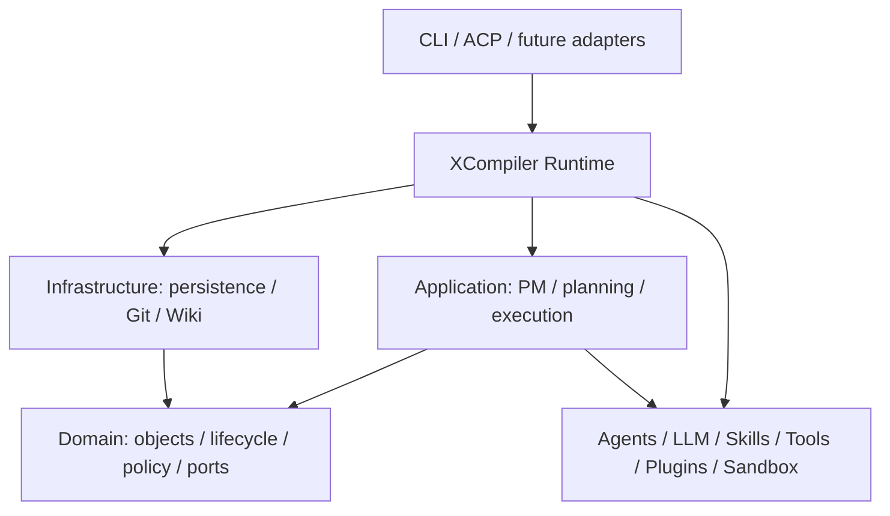

# XCompiler 领域与运行时设计

> XCompiler 是以 Runtime 为唯一业务入口、以领域对象和 Ticket 驱动迭代式 V 模型的软件工厂。

## 1. 设计目标

- `build` 负责需求澄清、复杂度判断、Phase 总计划和当前 Phase 详细计划。
- `run` 负责无普通聊天交互的自动执行，只在敏感操作时请求授权。
- CLI、ACP 和未来的 REST/GUI/SDK 都只能调用 Runtime。
- Planner 输出是可审阅的执行规格，领域对象才是生命周期、恢复和审计真相。
- 每次迭代都是完整 V 模型；错误不能跳过门禁，必须形成 Ticket 并按配对关系回退。
- 所有持久化对象使用全局唯一 UUIDv7；`name` 仅作为可读标签。

## 2. 分层架构



图中的箭头表示主要依赖方向。Runtime 组装具体实现并注入 Application；Domain 不反向依赖
Infrastructure，也不读取文件或启动进程。Infrastructure 还可实现 Application 声明的能力端口，
例如 `DebugWikiPort`，Application 不导入其文件实现。

0.4 已在工作树中移除 `src/core/`：计划、门禁等纯契约归入 Domain；规划推进、报告和执行协调
归入 Application；计划、项目清单和 Wiki 的文件存储归入 Infrastructure。`PlanStorePort` 区分
文档结构读取与严格执行计划加载，避免增量规划摘要意外触发执行门禁。Runtime 注入
`FilePlanStore`、`FileDebugWiki` 和对象仓库；这些迁移仍待统一验证，进度见
[0.4 交接记录](features/0.4.0/HANDOVER.md)。

Adapter 只负责参数或协议、配置、交互、输出和退出码。它不得直接调用 Planner、Agent、Tool、Plugin、Memory、文件系统或命令执行实现。

0.4 区分角色、工作和执行者。安装级 `RoleProfile` 说明身份、能力和专长；工作由 Step 类型与
Ticket 类型推导，非 Step 工作由 Runtime 指定。PM 在运行时组装并登记 Actor，记录角色 ID、
角色版本和可选模型池覆盖。计划不再指定角色，Actor 与指派从对象注册表恢复。

| 角色 ID | 默认模型池 |
| --- | --- |
| `project-manager` | `management` |
| `planner`、`requirements-analyst` | `planning` |
| `system-architect` | `design` |
| `python-developer`、`typescript-developer` | `coding` |
| `test-engineer`、`integration-test-engineer` | `testing` |

模型配置改用具名 `llm.pools`，替代 `llm.roles` 和 `llm.role_fallbacks`。五个默认池必须存在且非空。
使用角色默认池时，候选范围包含全局 `llm.fallbacks`；Actor 显式设置 `modelPool` 时只使用该池，
即使覆盖值与角色默认池同名也不继承全局 fallback。Router 只在固定允许范围内按有效评分调度。
Debug 是 `repair.debug` 工作，沿用 Step 执行者的角色和模型池，不再切换到 Debugger 人格。

`project-manager` 执行者代表项目判定交付结果，不执行技术 Step。已有 Project 的场景结果判定和阶段拆解
使用登记 Actor 的身份与模型池；建图前的需求澄清、阶段规划和阶段拆解保留无 Project/Actor 的操作身份，并固定其角色默认池。


## 3. 统一对象模型

每个持久化对象都包含统一 envelope：

```ts
interface ObjectEnvelope {
  id: ObjectId;          // UUIDv7，全局唯一且不可变
  name: string;          // P1-S004 等展示名，不参与关联
  objectType: ObjectType;
  projectId: ObjectId;
  schemaVersion: number;
  revision: number;
  createdAt: string;
  updatedAt: string;
}
```

对象类型：

| 对象 | 责任 |
| --- | --- |
| Project | 项目主题、Phase 集合、当前 Phase、项目交付和报告 |
| ProjectPlan | 复杂度、PhasePlan 列表、当前 Phase 与规划来源摘要 |
| Phase | 一次迭代目标、依赖、Epic、八个 Step 和阶段门禁 |
| PhasePlan | 单个 Phase 的范围、Step 列表、验证门禁和物化状态 |
| Step | V 模型阶段、输入输出、依赖、配对、KPI、尝试次数和状态 |
| Ticket | 工作、缺陷、增强和变更传导的唯一工作载体 |
| KPI / QualityAssessment | 可量化门槛、观测值、容差、证据和判定 |
| Changelist | Ticket 在某个 Step 的增量修改、commit 和验证证据 |
| Checkpoint | 不可变的对象快照引用和事件序号 |
| Deliverable / Report | 交付路径、验收条件和阶段/项目报告 |
| Log / AuditEvent | Ticket 日志及带 correlation/causation 的领域审计 |
| ActorRegistration / Assignment | 角色版本和可选模型池引用、Ticket 所有权和容量 |
| ProjectManagementPlan | PM 范围基线、状态、风险、决策和交互索引 |
| Decision / Risk / InteractionRequest | PM 决策、风险控制和用户授权证据 |
| TicketTraceEvent | 只追加、哈希链保护的 Ticket 流转调用链 |
| DomainEvent | 与对象修改同一 UnitOfWork 提交的 outbox 事件 |

关系只保存 ID 或 `{ id, objectType }`。父 ID 是权威关系；子列表和反向依赖是可校验投影。

## 4. Planner 与领域边界

`phasePlan.json` 和 `plan.P<N>.json` 是 Planner 规格：

- `phasePlan.json` 先描述一个或多个 Phase 的目标、范围、依赖和交付门禁。
- 只为当前 Phase 生成 `plan.P<N>.json`，后续 Phase 到达时才物化。
- Planner Step 使用 `S001` 等局部标签，包含 prompt、工具、输入、输出和最多两层子任务。
- Planner 文件不包含运行状态、重试状态或恢复游标。

Build 的 Application/PM 边界先准备 Project 与 Actor 身份，再由 Planning Compiler 物化工作图。
编译器不创建 Actor；Task 的创建人仍是技术执行者，Epic 和 Story 由 PM 创建。执行者和工作图原子保存后，
PM 立即注册全部 Ticket、记录活动 Phase 选择、导入澄清记录并刷新项目状态投影：

```text
Project
  ProjectPlan
  Phase P1 -> Epic P1
    Step P1-S001 -> Story -> Task -> Task
    ...
    Step P1-S008 -> Story
    Delivery Story
  Phase P2 (skeletal, not materialized)
```

`append/evolve` 保留现有 Project 和 ProjectPlan ID，把新需求重编号为后续 Phase。首个新增 Phase/Epic 依赖原末尾 Phase/Epic，不会替换或孤立已有 Ticket、报告和审计。

### 4.1 Agent Skills 能力层

`src/skills` 按 [Agent Skills Specification](https://agentskills.io/specification) 加载
`skills/<name>/SKILL.md`。Build 只把 `name + description` 元数据目录交给 Planner；Step 通过
`skill:<name>` 选择能力后，Run 才加载 Markdown 正文；`references/`、`scripts/` 和 `assets/`
由激活态只读 `skill_resource` 按需读取。未知 Skill、重复名称、目录/名称不一致、未知 Tool
引用或资源越界均明确失败。

Runtime 为 Build、Run 和后续 Phase 展开创建同一份能力图：内置 Tools/Skills 先注册，Plugin
API 3 再合并目录，最后统一校验引用。Skill 只组合 Tool 和工作方法，不拥有 PM/Ticket/V 模型、
权限、Git、质量门禁、Record/Replay 或 Debug Wiki 状态。Record/Replay 与 Debug Wiki 采用
“Skill 工作流指导 + Runtime 权威服务”组合，避免把持久化、脱敏、哈希链、检索和审计降为提示词。
完整目录和扩展合同见 [Agent Skills](agent_skills.md)。

### 4.2 需求接收与澄清

`build` 在规划前按下面的顺序接收需求。topic 模式（`--topic`）视为已完成接收，不再提问。

1. **固定问题。** 先问开发语言（`python`/`typescript`），再问交付形态：`application` 是可运行程序，
   `library` 是库或 SDK，`mixed` 是两者兼有。这两题由代码提出，以类型化选项作答。
   - 增量构建沿用已有项目的语言和形态。
   - 需求原文已经写明的，不再询问，只记录来源。
2. **动态澄清。** 之后每轮只发一次 PM 请求（`planning-clarification/2`）。
   - 模型读取已决定的语言和形态以及全部问答记录，返回三者之一：下一题、需求已清晰，或 XCompiler
     无法交付（`infeasible`）。
   - 每轮附带可实施性判断，只按 XCompiler 的能力边界判断：
     - 已决定的语言；
     - 三种交付形态；
     - 验收必须能通过在沙箱中运行一条命令并读取结果完成；
     - 配置给该语言的沙箱方式与网络策略。
   - 判断结果为 `feasible`、`uncertain`（取决于未确定的决策）或 `infeasible`。不是 `feasible`
     时须列出类型化的阻碍：`language`、`platform`、`verification`、`environment`。
   - 每轮附带六个维度的覆盖状态：功能（functionality）、数据（data）、验收（acceptance）、
     边界（boundary）、质量（quality）、扩展性（extensibility）。状态取值为 resolved、open
     或 not-applicable。
   - 结束由模型判定，代码只检查回复自洽：
     - 判定清晰须同时满足可实施性为 `feasible`、没有 open 维度；
     - 判定清晰时须列出默认假设（`assumptions`，1–12 条）：每条写明一项没有提问、交给规划决定的事项及其默认值，
       例如输出包含哪些字段、输出文件如何组织、接受的输入编码、验收用什么样例；
     - 判断为 `infeasible` 时不得继续提问；
     - `feasible` 不带阻碍，其余判断至少带一项阻碍。
   - 题目只能针对 open 维度，不得重复已问过的问题。
   - 不得再问语言、运行时、包管理器、测试框架或交付形态。
   - 题号由代码分配。违反以上任一规则的回复，作为业务校验失败退回模型重答。
3. **无法交付时由用户决定。** 模型可能判断错，所以不自动终止。用户看到原因和阻碍后选择：
   - 接受模型给出的最接近的可交付范围：作为一条问答记录，继续澄清。没有给出范围时不提供此项。
   - 修改需求：之前的问答保留，用修改后的需求继续澄清。
   - 仍按原需求继续：结束澄清。
   - 取消 build：审计记为在 clarification 阶段取消。

   每次选择都记为 `compile.clarification_infeasible`。
4. **上下文预算与最终评估。** 每道题都重新发送此前确认的全部内容，所以澄清的上限是上下文。
   - 预算分两侧计算。每侧取对应池首选 provider 的窗口，扣除安全余量和最大回复预留，再乘以
     `planning.clarification.context_ratio`（默认 0.7，取值 0.2–0.9）：
     - 澄清侧（management 池）：每轮发送前，估算本轮澄清提示的 token 数。
     - 规划侧（planning 池）：规划读取的是 topic.md，所以估算的是按当前问答渲染的 topic.md，
       加上阶段拆解（最大的规划请求）自身的系统提示、Skill 目录、模板和基线摘要，再加一份
       PhasePlan 预留（规划模型的最大回复）。
     - 两侧都不含 Rule 块，由比例余量覆盖。任一侧达到预算时，本轮改为最终评估（`budget`）。
       预算用量取两侧中较高者，向下取整，所以仍在提问的一轮不会显示 100%。
   - 连续 `planning.clarification.stall_turns`（默认 4，取值 2–20）个回答都没有推进澄清时，本轮也改为
     最终评估（`stalled`）。推进指已澄清（非 open）的维度数超过此前最高，或可实施性判断改变；模型把
     某个维度改回 open、再改回来，或在维度之间来回挪动 open，都不算推进。判断只读覆盖状态与判断两个
     类型化字段；最高值随接收草稿保存，续问后照常累计。
   - 澄清提示要求模型不就字段格式、取值写法、数字表示、排序、表头布局等规划可按默认处理的呈现细节
     提问；维度只剩这类细节时标为 resolved。
   - 最终评估不得提问，只能返回 `clear`、`infeasible`，或 `unresolved`。`unresolved` 列出仍阻碍
     交付的未决点（`openPoints`，每项须属于 open 维度），并可给出最接近的可交付范围。
   - 模型给不出可用的最终评估时，由代码生成最终评估：未决点取最后一次有效回复中仍为 open 的
     维度，阻碍沿用其判断，并记 `compile.clarification_final_unavailable`。这里"给不出"只有两种
     情况，按类型化字段判断：所有候选的回复都被业务校验拒绝（`contentRejectedOnly`）；或没有
     provider 放得下请求（`provider_capacity_exhausted`）。用户照常选择，澄清不会因此中断，也不会
     在续问时卡住。
   - 用户选择：
     - 接受范围，结束澄清，进入 Gate 1；
     - 修改需求；
     - 按已确定的内容进入 Gate 1；
     - 取消；
     - 因停滞触发时，另有"继续澄清"。
   - 预算用完时修改需求：编辑器预填需求原文加全部已确认回答。保存后只保留语言和交付形态两道
     固定题，从修改后的文字重新澄清。题号继续递增，审计中不会重复。
   - 任何时候修改需求后，原先从需求原文推断出的语言与交付形态都按新文字重新判断。新文字不再
     说明的，补问固定题；用户自己选的和沿用已有项目的保持不变。语言变化时，澄清模型、沙箱和
     规划侧的估算一起更新。
   - 中途接受缩小范围后，停滞计数清零。
   - 每次选择记为 `compile.clarification_final`。结束原因记为 `compile.clarification_ended`，
     包含是否经过最终评估、预算、窗口和未决点。
   - 模型判定清晰时，默认假设写入 topic.md 的“默认假设”一节，并注明它与已接受的需求同样有效、不符合时在 Gate 1 编辑。
     规划读 topic，因此受它约束；开启提示翻译时，用户看到译文，规划读模型原文，该节的标题与说明是预设行。
     结束记录 `compile.clarification_ended` 带有这些假设。
   - 模型判定清晰之外的结束方式，都把未决点写入 topic.md 的“未澄清项”（最终评估给出的带说明）。
     最后的判断不是 `feasible`，或用户缩小过范围、选择过继续时，写入“可实施性”一节。
   - 回答直接回车即取推荐的 A。回答写入任何地方之前，先按审计的凭据脱敏规则处理，覆盖范围
     包括发给模型的内容、topic.md、草稿和审计；有内容被替换时提示用户改用环境变量提供密钥。
   - 每道题前显示已澄清维度数、可实施性判断和预算用量。提示中不变的说明在前，问答记录在后，
     每轮变化的题号、预算和最终评估放在最后，便于 provider 复用前缀缓存。
   - 每个回答后，接收状态保存到状态工作区的 `drafts/build/intake.json`。同一需求（摘要相同）、
     同一意图，并且用户语言与提示语言都相同的下一次 build 会询问是否继续。topic.md 落盘或取消时删除；无法读取的草稿提示、记录
     `compile.intake_draft_invalid` 后丢弃。
5. **topic.md 记录。** 固定决定写入 front matter（`xcompiler-topic: 1`、`language`、`projectType`），
   正文另有“已确定的决定”一节。
   - Gate 1 之后以 front matter 为准，包括 Gate 1 编辑后的值；`--topic` 重跑也从这里读取。
   - 带 `xcompiler-topic` 键但取值未知时，以 `topic_front_matter_invalid` 拒绝，不发起任何模型调用。
   - 没有 front matter，或 front matter 属于其他工具时，按原文推断语言。
   - topic.md 中每道已回答的问题只保留问题和回答，回答本身已含所选项的文字。理由和未选的
     选项不再写入，规划要读的篇幅约减半。
   - 规划只读 topic.md，不再另外接收一份问答列表。这样问答篇幅不会翻倍，Gate 1 改过的回答也
     不会与旧回答矛盾；后续 Phase 与 `--topic` 本来就是如此。
   - 补充需求同样只在 topic.md 中：规划和后续 Phase 不再单独发送 userAddenda。单独发送的那份会
     声明优先于原始需求，Gate 1 修改补充需求后它仍是旧内容，会与 topic 矛盾。`plan.userAddenda`
     只作记录，取自 Gate 1 之后 topic 的补充需求一节（`--topic` 重跑同样如此），计划自身的检查因此
     与规划读到的一致。
   - Gate 1 只接受确认、编辑、取消三个值，其他值按 `intake_choice_invalid` 拒绝，不会当作确认。
   - 前端在用户关闭提示而未作答时抛出 `InteractionDismissedError`（`interaction_dismissed`）。
     ACP 中客户端拒绝或取消选择、输入、编辑请求即属此类。Build 收到后按取消结束：记审计，不再
     调用模型，保留未完成的接收草稿以便续问。
6. **交付形态固定。** 阶段规划给出的 `projectType` 与已决定的不同时，以决定值为准，并记录
   `compile.project_type_pinned`。

### 4.3 语言与提示翻译

`locale`（`en`/`zh`）是用户的语言，`prompt_translate`（`off`/`on`，默认 `off`）决定模型读什么语言。

1. **两种语言。**
   - 用户语言即 `locale`。CLI、交互提示、问答展示与报告用它；写进生成工程的自然语言交付物也用它，
     包括文档、报告、提交信息、生成代码中的注释与文件清单。
   - 提示语言（`getPromptLocale()`）是模型读的语言。`prompt_translate: on` 且 `locale` 不是 `en`
     时为 `en`，否则等于 `locale`。`locale: en` 时开关不起作用，不发生任何翻译。
2. **有预设的文字直接替换，不翻译。** 以下内容都有各语言版本，按提示语言选取：
   - 提示模板与 Rule；
   - 工具描述和工具错误提示；
   - Planner 校验反馈、Executor 反馈、响应未通过校验时的重答提示；
   - 入口门禁在没有进程输出时合成的说明（缺少入口文件、`--help` 无输出等），它们是模型修复时读的证据；
   - Step 契约与 calibration 文字。
3. **没有预设的文字由 LLM 翻译。**
   - 翻译随问答即时发生：每轮送给模型前翻译需求原文、修改后的需求、自定义回答和补充需求；模型输出后
     把题目、理由、选项、结论摘要、阻碍与未决点说明、建议的范围译成用户语言再显示。选择预设选项的
     回答直接取该选项的模型原文，不翻译。
   - Gate 2 的计划预览译成用户语言显示；计划本身保持模型写的英文。
   - topic.md 保持用户语言。模型读的英文 topic 由已有译文直接拼出，不在最后整篇再译：
     - 需求、问答（模型原题与送给模型的回答）、补充需求、已确定的决定、未决点都用模型侧已有的文字，
       按英文预设渲染；
     - 每一节"用户语言原文 → 英文"作为译文写入缓存。各节按开头的预设行配对；两侧预设行对不上时
       （例如需求原文里恰好写了 XCompiler 的标题行）一节都不配，避免缓存错误译文；
     - 插件在 `compile.afterClarify` 改写了问答记录时，问答一节不配对，读取时重新翻译；
     - 可实施性一节没有模型侧原文，读取时翻译。
   - 规划、后续 Phase 和 `--topic` 重跑都按节读取 topic.md：
     - front matter 原样保留；
     - XCompiler 自己写的行（标题、引言、各节标题、未澄清项说明）有预设，直接换成英文版本；
     - 其余文字按节翻译，每节一次请求，前后的空行原样保留。

     未改动的节命中缓存，只有 Gate 1 改过的节、可实施性一节或从未见过的 topic 文件才发翻译请求；
     按标题查找章节的代码在任何语言下读到的都是同样的标题。
   - 交付物不经翻译，由模型直接用用户语言写（见第 4 条）。
4. **交付物语言。**
   - 规划与执行请求的载荷同时记录 `locale`（提示语言）和 `outputLocale`（用户语言）。Rule 上下文的
     `outputLanguage` 取 `outputLocale`，缺省为 `locale`。
   - Rule 文本可以引用变量 `{{outputLanguage}}`，目前只有这一个。渲染时按提示语言填入语言名，
     英文提示写 `Simplified Chinese`，中文提示写 `中文`。
   - Rule 校验拒绝未知变量，也拒绝同一文本的各语言版本引用不同的变量。
   - `outputLanguage` 不是适用维度，不影响 Rule 是否适用。
   - `base-output-language`（1.1.0）要求交付物使用 `{{outputLanguage}}`，写给模型的计划、提示和
     推理使用说明本身的语言。
5. **翻译请求。**
   - 与其他业务请求走同一条保留请求路径：Rule 快照、审计、Record/Replay。
     - 模板为 `text-translation/1`，协议根对象为 `{"translations":[...]}`。
     - 归属 `text-translation`，work 为 `text.translate`，角色 project-manager。
     - 配置了 `llm.pools.translation` 时用该池，否则用 PM 的 management 池。
   - 回复须与原文逐条对应：条数相同、每条为非空字符串，代码块、行内代码和 `{{...}}` 变量原样保留。
     不满足时作为业务校验失败退回模型重答。
   - 同一方向的同一文本只翻译一次。
     - 译文缓存在状态工作区的 `translations/<sha256>.json`，键为模板版本、方向和原文。
     - 读不出或内容不匹配的条目按未命中处理。
   - 翻译服务失败时保留原文，显示 `translation.fallback` 警告，并记审计 `translation.fallback`。
     服务失败指 `LLMRequestError`（`provider_not_configured` 除外）或 `ProviderCapacityExhausted`。
     取消、池未配置、审计写入失败不属于此类，照常抛出。
6. **恢复。** calibration 文字取自解析器自有的语言表（`calibration_text.ts`），不调用 i18n 渲染。
   - 写进计划的 calibration 文字由 `buildPlan` 按当前提示语言生成。
   - 解析规划回复时做的规范化只用于校验，结果不进入草稿，固定按英文进行。
   - 因此当前 `locale` 或开关后来变了，恢复结果也不变。
7. **调试。** `rule render --output-language <locale>` 渲染指定交付物语言下的 Rule 块。

## 5. 迭代式 V 模型

每个 Phase 固定八个 Step：

```text
REQUIREMENT_ANALYSIS ---------------------- FUNCTIONAL_TEST
       HIGH_LEVEL_DESIGN --------------- MODULE_TEST
              DETAILED_DESIGN ------- INTEGRATION_TEST
                         CODE --- UNIT_TEST
```

配对关系：

| 产出阶段 | 验证阶段 | 同步生成内容 |
| --- | --- | --- |
| REQUIREMENT_ANALYSIS | FUNCTIONAL_TEST | 功能验收基线计划和可执行用例 |
| HIGH_LEVEL_DESIGN | MODULE_TEST | 系统、模块和接口契约测试 |
| DETAILED_DESIGN | INTEGRATION_TEST | 集成场景和测试 |
| CODE | UNIT_TEST | 单元测试计划和用例 |

门禁包含三类验证：交付物/方案校验、配对基线测试、风险驱动的追加功能测试。S1-S4 产出阶段交付物和配对基线测试，其门禁由“阶段特有的交付物/方案校验 + 基线测试资产校验与执行”组成。首次正向执行 S1-S3 时产品代码尚不存在，只显式跳过基线的可执行运行；交付物、方案、追溯关系以及基线测试资产仍必须通过校验。S4 始终执行单元基线。任何由 S4-S8 发现的问题回退到 S1-S3 后，代码基线已经存在，回退阶段必须执行其精确配对基线后才能重新交付。

| Step 场景 | 本阶段产生 | 交付门禁 | 基线执行策略 |
| --- | --- | --- | --- |
| S1-S3 首次正向执行 | 阶段交付物、阶段特有校验依据、配对基线测试 | 交付物/方案校验 + 基线测试资产校验 | 仅跳过可执行运行，并记录 `initial-pre-code` |
| S1-S3 纠正执行，因果链起点在 S1-S3 | 对本阶段交付物和基线的增量修正 | 交付物/方案校验 + 基线测试资产校验 | 仍无代码基线时跳过，并记录 `pre-code-correction` |
| S1-S3 纠正执行，因果链起点在 S4-S8 | 对本阶段交付物和基线的增量修正 | 交付物/方案校验 + 精确配对基线 | 必须执行；Bug、Enhancement、父/子 CR 的多层传递不得丢失原始回退阶段 |
| S1-S3 契约变更跳（`changeKind: contract-change`，不论起点） | 规格与配对基线一起改到新契约 | 交付物/方案校验 + 基线测试资产校验 | 跳过可执行运行，并记录 `contract-change`：基线在 S4 应用变更前必然失败，由同一变更链中配对的 S5-S8 执行 |
| S4 | 代码交付物、单元基线测试 | 交付物/方案校验 + 单元基线 | 必须执行 |
| S5-S8 | 独立风险分析和验证阶段拥有的追加功能测试 | 冻结后的配对基线 + 追加功能测试 | 必须完整执行 |

该规则由领域对象直接承载：`DeliveryGate.validationTypes` 保存 `deliverable-validation`、`baseline-test`、`supplemental-functional-test` 的组合，`baselineExecutionPolicy` 保存 `defer-until-code`、`required`、`freeze-then-required` 或 Phase 聚合策略。状态机依据这些字段执行，LLM 不能通过自定义 Step 文本改写门禁类别。

S5-S8 不修改左侧基线：它们独立复核基线并做风险分析，只能在各自的验证命名空间追加聚焦的功能测试；随后冻结“基线 + 追加测试”集合并完整执行。测试自身缺陷、产品缺陷、完整度/质量短板分别建票，依赖问题走独立路由。八个 Step 都不拥有绕过 Record/Replay 的真实网络特权。

规划契约：用户确认的规划（需求摘要与当前 Phase 的目标、范围）作为「已确认的规划契约」进入每个 Step 的提示，
位于项目全局约束之后、已装配上下文之前；本 Phase 已接受的契约变更晚于它，二者不一致时以契约变更为准。
Step 冻结、设计或实现的内容必须与它一致；上游文档或测试与它不一致时，可写范围内的按契约修正，范围外的写入
`qualityAssessment.blockedBy` 并指明负责的 Step。负责冻结契约的需求分析若看不到规划已定的契约，就会自行设计
一份，此后每个 Step 都以冻结文档为上游而彼此一致，直到交付门禁才与规划对照出差异。

## 6. Ticket 模型

Ticket 类型固定为：

- `epic`：一个可交付 Phase。
- `story`：八个 Step 工作项和最终 Delivery 工作项。
- `task`：Story 下的计划工作，最多再嵌套一层 Task。
- `bug`：错误行为、命令失败、测试失败或异常，进入 Debug 流程。
- `enhancement`：功能缺口、测试不完备或质量指标不足。
- `change-request`：承接已接受上游变更，或承接真实场景证明必须调整的已接受契约，向受影响下游 Step 传导增量。

Ticket 通用字段包含角色、Agent、0-255 优先级、父/根 Ticket、依赖、阻塞项、关联项、检查点、日志、changelist、solution 和 source。source 保存 correlation ID、causation ID 及外部来源。调度工作不再持久化第二份 `mode`；Runtime 仅在执行边界由 Ticket 类型派生 `normal`、`debug`、`enhancement` 或 `change-request` 模式，避免生命周期事实与执行副本漂移。

Bug 额外持久化结构化 `failure.identity`、`verificationContract` 和只追加的 `verificationRecords`。身份由失败类别、机器码、失败/目标/验证 Step、操作、失败测试选择器、目标产物及状态码组成，不包含摘要、完整日志、临时目录、计数器或模型措辞。原始验证 Step 通过后立即记录身份哈希、QualityAssessment 和实际测试选择器；CR 若仍需继续下游影响分析，最终跳复用这份证明而不是要求另一个 Step 冒充原验证门禁。每次发现都先创建独立 Bug；PM 注册后、分配前才比较同一目标 Step 上更早的活动 Bug。命中时保留两张票，以 `duplicateOfTicketId` / `duplicateTicketIds` 双向关联，把后到票停放为 `pending:duplicate`，并记录治理决策；原票终态后再取消重复票。PM 不合并两者的技术上下文。

Change Request 使用 `changeKind` 区分纠正传播、依赖变更和已接受契约变更，使用 `sourceTicketIds[]` 保存全部来源、`originFailures[]` 保存全部起因失败，并以 `propagationStepIds[]` 明确本链的受影响 Step。传播范围必须从当前目标 Step 开始，只包含同一 Project/Phase 内唯一且按 V 模型顺序递增的 Step；非法范围在创建任何 Ticket、关系或生命周期变更前拒绝。相同纠正传播跳可以折叠多个来源，但不能丢弃任一来源、契约差异、changelist 或验证要求。最终跳关闭前必须一次性重放所有仍活动源 Bug 的原始验证契约；少一个失败用例都整体拒绝关闭，不能先关闭 CR 再留下半数源票。

Phase 真实场景的进程状态、40X/50X、重定向、超时、异常和空结果只作为现场证据。`project-manager` 执行者根据已接受需求、场景预期与完整证据判断：契约仍有效而实现错误时创建 Bug；满足预期必须调整需求、能力、接口、依赖、数据源或设计前提时直接创建 `contract-change` CR 并从归属 Step 向下游传播。LLM 判定缺少合法 Ticket 类型或归属 Step 时门禁失败，不允许静默通过或默认归类。

Ticket 状态机：

```text
created -> in_progress | pending | cancelled
pending -> in_progress | cancelled
in_progress -> pending | resolved | cancelled
resolved -> closed | reopened
reopened -> in_progress | cancelled
cancelled -> reopened | closed
```

纠正类 Ticket（Bug / Enhancement / CR）的每个状态各有确切含义,三者不可互相顶替:

- **`in_progress`** —— 正在修复。
- **`resolved`** —— 修复已落地,**且本 Step 自己的检查已通过**;等待的是发现该失败的那道门禁的裁决。
  停驻到这个状态要出示**属于本 Step 且通过**的 QualityAssessment,不是模型声称完成即可。
  领域状态机只要求存在 solution,因为关闭路径会途经此状态;应用层的统一评估校验同时约束
  Change Request 主交接和特殊汇合路径,不能从旁路把未通过门禁的修复写成 `resolved`。
- **`reopened`** —— 那道门禁把同一个失败又报了一次,即裁决为否。**重开原票而不是新开一张**:
  按失败身份与目标 Step 匹配。新开会让原票永远停在 `resolved` 等一个已经回来的答复。
- **`closed`** —— 裁决为是。要求已验证的 solution **且**原始失败在观察到它的 Step 上重放通过。
- **`pending`** —— 只表示被别的事物阻塞,不表示「已完成待验」。混用这两种含义会让调度器把活
  重新派给刚刚完成它的 Step:一次实跑因此让同一张 Bug 在 `pending → in_progress` 之间循环三轮,
  反复重做已经落地的修复。

调度器不把工作交给 `resolved` 的 Ticket —— 它的工作已经做完,欠的只是裁决。


## 7. Step、Phase 与 Project 状态

Step：

```text
created -> in_progress | pending
pending -> in_progress
in_progress -> delivered | pending
delivered -> closed | reopened
reopened -> in_progress
closed -> reopened   # 已验证上游 CR 可重新打开
```

每个 Step 都包含结构化 `deliveryGate`：

- S1 额外校验需求产物对 topic 的追溯、可观测验收条件、范围、约束和未决项，并校验功能基线设计。
- S2 额外校验系统定位、模块边界、外部接口/API、依赖和所有权，验证架构可行性及模块测试追溯。
- S3 额外校验内部数据/控制流、异常处理、实现契约和上游架构对齐，验证实现方案及集成测试追溯。
- S4 额外校验代码对详细设计、源码所有权和公开契约的对齐，并执行构建/静态检查与单元基线。
- S1-S3 首轮只将基线执行记录为 `skipped-initial-pre-code`；由 S4-S8 触发的回退不得使用该跳过理由。
- S5-S8 是 `verification-acceptance` 门禁，检查基线独立评审、追加功能测试归属、冻结后的完整执行、KPI 与 tolerance。

Phase 也包含 `deliveryGate`，覆盖完整交付物、集成构建/测试及真实用户场景 case。Runtime 在关闭 Replay 的真实环境运行每个 case，并保存操作、命令、环境、时间、退出状态、超时和输出尾部。

场景用结构化字段声明它读取什么、应当怎样结束，门禁不从文字中推断：
- `inputs`：场景读取的工程文件。必须是编码之前的 Step（REQUIREMENT_ANALYSIS、HIGH_LEVEL_DESIGN、
  DETAILED_DESIGN）或 FUNCTIONAL_TEST（例如在测试阶段获取真实数据）的声明产出；CODE 不提供验收输入，产品
  与验收相互独立。规划校验拒绝不满足的 StepPlan；门禁运行场景前检查输入存在，缺失时不运行，说明缺少的
  文件及应产出它的 Step。
- `execution.expectExitCode`：期望要求特定非 0 退出码时声明；进程结果按它判定，未声明即 0。
- 进程结果与裁判结论矛盾（进程未按声明结束而裁判认为期望已满足）时，说明场景契约自相矛盾，run 中没有
  Step 能修正。门禁以明确原因失败、不建 Ticket，并给出追加需求的修改建议；用户在 topic.md 的
  「用户补充需求 (Addenda)」一节追加后重新 build。追加需求与原始描述、澄清问答或默认假设冲突时以追加
  需求为准，规划提示随需求一起说明这一点。
- 裁判只看到可读的证据：产物不是文本（含 NUL 字节或不是有效 UTF-8）时，只告诉裁判它是二进制、多少
  字节、内容不可读，不把字节解码成乱码交给裁判。
- `inspect`：结果无法作为文本读取（电子表格、图片、压缩包等）的场景，声明若干检查命令（写法同
  `execution`），用工程自身的依赖读取结果并输出期望要核对的内容。门禁在场景之后运行它们，输出写入
  scene 的 `inspections`，作为裁判的证据。
- 无法核对即不通过：裁判规则（`scenario-outcome` 3.1.0）要求期望中没有可读证据能证明的部分视为未满足，
  没有矛盾不等于得到证明；这是失败的唯一原因时裁判返回 `unverifiable: true`（模板 `scenario-outcome/3`）。
  门禁对此以明确原因失败、不建 Ticket，并给出追加需求的修改建议（为场景声明检查命令），因为让证据可读
  是场景声明的事，run 中没有 Step 能修正。
- 裁判同时看到规划与冻结需求：`plannedScope` 是当前 Phase 的已确认范围，`frozenRequirements` 是本 Phase
  需求分析文档（有界截取）。规划与已接受的契约变更优先于冻结需求。
- 有冻结需求时，裁判必须先单独回答 `planConflict`（模板 `scenario-outcome/5`，规则 `scenario-outcome` 3.3.0）：
  冻结需求是否在规划已明确的某一点上定得与规划不同，冲突时引用双方原文。缺少这一回答的回复不可用，门禁
  记为未评判。Runtime 按这个结构化字段分流：冲突时不论裁判其余结论（通过、无法核对或其他归属）如何，都建
  `change-request` 指向 `requirement-analysis`（finding 代码 `scenario_plan_conflict:<场景>`），由需求分析把冻结
  需求改回规划，再经变更请求逐级传到以它为基础的 Step。只在长规则里写“规划优先”时，实跑中的裁判仍按冻结
  文档判表头正确；单独回答的字段才让它真正去比对。
- 场景 finding 交给设计阶段 Step（需求分析、高层设计、详细设计）时，可修改的产物取当前 StepPlan 中该 Step
  声明的全部产出（阶段文档、测试计划、配对的可执行测试及样例等），因为契约变更要让规格与断言它的测试一起改；
  交给 CODE 时仍为 `src/`。不再写死单个 P1 文档路径，后续迭代按各自的声明产出。
- 判为无法核对时的修改建议按场景是否已声明 `inspect` 区分：未声明时建议声明检查命令；已声明时建议核对
  命令读取的是否正是期望要核对的内容、产物结构是否与规划一致。

运行产物不进入工程历史，也不留在工作区：
- Runtime 维护工程 `.gitignore` 中的运行时规则，但不在规范分支上为它单独提交：规范分支只由 XCompiler
  合并推进，单独提交会让已对旧头部通过合并门禁的请求无法落地。合并前，若 `.gitignore` 相对已提交内容
  只多出 Runtime 自己的规则，就把它恢复为已提交内容再合并；规则随票据分支的提交或下一次静止点提交
  （如门禁报告、交付清单）进入规范分支。其他人对该文件的修改不处理，仍然阻止合并。
- 运行时临时目录 `.xc-tmp/`（写入工程 `.gitignore` 与仓库 exclude）按门禁或尝试分子目录：
  `.xc-tmp/gates/<Phase>-delivery/<时间>/`、`.xc-tmp/steps/<Step>/attempt-<n>/`。Runtime 只移入、不删除，
  由用户清理。
- 交付门禁：运行前记下工作区已有的改动，证据采集完后把门禁期间新增或改动的文件按相对路径移入本次门禁
  的子目录；已提交的文件先把改后的内容存入该目录，再恢复为已提交内容。否则场景输出会留在规范工作区，
  后续每次合并都因未提交改动被拒绝。
- 门禁报告 `docs/delivery/<Phase>-delivery-gate.md` 是交付物：记录各项检查、场景命令与退出码、检查命令
  输出、判断与 finding、产物去向；每次门禁运行（通过或失败）都写入并由 Runtime 提交。
- Step 尝试：提交前，把运行产品或测试时写到本 Step 可写范围之外的文件移入本次尝试的子目录并记审计；
  工具不能写到范围之外，所以范围外的改动都来自运行。`.gitignore`、Runtime 自有文件和依赖锁文件除外。Phase 在八个 Step 和所有纠正 Ticket 关闭且 Phase QualityAssessment 通过后执行 Delivery Story，随后 `delivered -> closed`。Project 根据 Phase 依赖选择下一个可运行 Phase；所有 Phase 关闭后才 `delivered -> closed`。

## 8. 调度规则

Application 层的 PM Orchestrator 是唯一项目推进者；它通过 `WorkScheduler` 选择工作，通过领域状态策略验证每次跳转：

1. 优先恢复唯一的 `in_progress` Step/Ticket。
2. 否则按 Step 依赖选择首个就绪项。
3. 同一 Step 优先执行未阻塞的 CR，其次 Bug、Enhancement，最后普通 Story。
4. CR 已记录 application 的 Step 不得重复调度。
5. Step 尝试前递增 `attempts`；达到 `maxAttempts` 时明确失败。
6. 没有可运行项时，执行 Phase `deliveryGate`；只有所有 Step、Story、纠正 Ticket、完整交付物和真实场景验收通过才允许关闭 Phase。
   门禁失败、问题经 PM 接收后仍没有可调度的工作时，以明确原因停止，不重跑门禁：重跑只在有修复落地后才有意义，
   否则同一产品被反复评判、每轮都新建重复票，而每轮新建的对象又让进展守卫以为有进展。
   挂接变更请求的 Bug 由该变更请求承载，前提是变更请求仍未关闭；变更请求都已关闭后被门禁重开的 Bug，
   在其修复 Step 上重新调度。
7. 调度不使用固定的全局跳转次数。`ProjectProgressGuard` 比较 Phase、Step、Ticket、
   ChangeSet、Merge Request 和 Gate 的语义快照；只有连续三次调度后状态完全没有推进才停止，
   因而复杂项目不会因规模大被误杀，真实循环也不会无限消耗模型额度。

数组顺序不构成依赖，显示名不构成身份，Planner 状态不参与裁决。

Ticket 只在 Phase 内产生和消费。Phase 内的 Task、Bug、Enhancement、CR 由掌握技术上下文的发现角色创建；Phase 外部只能向 PM 提交问题、数据和现场，不能构造 Ticket。PM 的统一 intake 校验结构化报告后创建 Phase 内 Ticket，再按能力、状态、容量和稳定排序路由。该入口保留 `external-usage` 来源，用于后续交付后问题重启 V 流程，本版本不开放 Project 自动重激活。所有权由已接受 Assignment 表示；每次提交、注册、路由、接受、转交和关闭都追加不可变 TicketTraceEvent。

## 9. 错误、Enhancement 与 CR

普通 Step 失败：

```text
failure -> Bug -> paired source Step Debug
        -> proposed solution + CR
        -> affected downstream Steps apply delta
        -> every quality gate passes
        -> CR closed -> Bug verified/closed -> Debug Wiki
```

质量门禁不足：

```text
quality gap -> Enhancement -> owning source Step incremental completion
            -> CR -> affected verification -> close
```

CR 下游失败：

```text
parent CR failure -> linked Bug (parent CR pending/blocked)
                  -> paired source Debug
                  -> child CR verifies repair
                  -> child CR and Bug close
                  -> parent CR resumes remaining unapplied Steps
```

失败尝试在 Git 快照事务中执行；未通过门禁时回滚工作区。通过的尝试记录 QualityAssessment、Changelist、commit 和证据。失败日志抽取核心原因并挂到 Ticket 的领域 Log，完整过程仍保留在人类审计文件中。
工具失败的审计记录（`tool.result`）除展示用的消息外，还在数据中保存工具给出的 `error`（诊断与下一步）
和失败码 `code`；消息在有摘要时只显示摘要（运行器即输出末尾），否则这两项不在任何持久记录中。

### 9.1 失败身份与不收敛守卫

同一个失败反复出现却修不好时，尝试预算必须能停下来。判定「是否同一个失败」靠结构化签名，
而不是错误文本：

- 签名只由**失败是什么**构成——失败的用例、失败类型、失败原因的稳定部分以及目标文件。
- 签名不含**这次尝试怎么跑的**——工具调用的命令行、运行器分配的临时目录、对象地址、计数器。
  这些在两次完全相同的失败之间也会变，混进去会让每次失败都成为「新」失败，守卫永远够不到阈值。
- 采集失败用例必须要求肯定式的失败标记。冗长模式下运行器会先打印用例 id、再打印该用例自己的
  输出，靠排除 PASSED 行反而会把通过的用例算进去；行尾的 `FAILED` 也不得与下一行开头的 id 绑定。

测试运行的身份：有门禁的 `run_tests` 跑哪些测试由 Runtime 决定，工具在结果中记录实际运行的测试集
（`selectors`），调用方追加的运行选项（`-q`、`-p no:cacheprovider` 等）不计入。同一工作目录下，后一次通过的
运行若覆盖了此前某次失败运行的测试集，该失败即视为解决；执行器的轮内判定与尝试级判定一致。否则 Runtime 在
修改后自动追加的门禁通过、而调用方此前带选项的那次失败永远找不到"相同参数的通过"，后续同参请求又被门禁
复用而不再执行，Step 会在测试全绿时耗尽轮次。`run_program` 仍按完整参数识别。

同一签名连续复现达到阈值即判定不收敛，Ticket 停止并给出原因，而不是耗尽剩余预算。停止信息写出复现的
是哪个失败（失败码和原因的第一行），不只写"同一失败复现了 N 次"。

无改动修复后复现即停止：已解决、等待原验证的 Bug 被同一失败（相同失败身份）复现时，若它在目标 Step 上最近
一次修复的 changelist 没有任何文件条目，Runtime 不再重开它，而以类型码 `repair_recurred_unchanged` 停止运行、
记审计 `domain.repair_recurred_unchanged`。同样的输入只会得到同样的结论，重开只会把尝试上限一起抬高、无限循环。
判断在写入任何状态之前进行，Bug 保持原状。停止信息写明 Bug、目标 Step、失败码与 changelist，并给出处理方式：
需求或规划需要调整时在 topic.md 追加需求后重新 build，需求无误而实现有误时修正后再 run。门禁接收、Step 结果
处理与合并门禁失败三条路径都按类型码转为停止。有文件改动的修复照常重开重试。

### 9.2 同跳合并

两条 Change Request 传导同一跳（相同源 Step、目标 Step、起因失败 Step 和父 CR）时，后一条并入已经
承载该跳的那条，而不是各自开链。折叠后的 CR 显式保存全部 `sourceTicketIds`、`originFailures`、契约差异和传播范围；被并入的来源同时移交，避免它仍然可被调度。最终验证必须覆盖每个源 Bug 的精确失败选择器，完成后再统一关闭来源。

### 9.3 Bug 关闭的验证契约

Bug 关闭的依据不是「某个 Step 的门禁过了」，而是**开票的那个失败重跑一遍并通过**。

每张 Bug 携带一份验证契约：失败被观察到的 Step，以及要重放的测试选择器。契约只可能在那一个
Step 上被满足——别处跑什么都不构成对它的证明。满足时追加一条不可变的验证记录，链上后续跳凭
记录即可放行。

未满足时**拒绝关闭，而不是抛出异常**。一条尚未完成的纠正链与一条损坏的纠正链不同：Bug 留在
打开状态，它的 Story 保持阻塞，工作仍然可见，下一条到达该 Step 的链还能把它做完。以异常终止
整轮运行，会把一个可恢复的状态毁掉，只因为有活没干完。

这条原则贯穿纠正流程的每一处判定：**能推进就推进，不能推进就停在原地并说明，不要终止运行。**

会合点是唯一的例外形状：那里 Bug 被交给它所修复的 CR，由那张 CR 去跑证明它的 Step。交接必须
同时释放 Bug 对该 CR 的阻塞——否则 Bug 等着一道门禁，而那道门禁被 Bug 自己挡着。

### 9.4 重复缺陷

同一个失败被报告多次时，每一次都保留为独立 Ticket，由 PM 在**路由前**判定重复：目标 Step 相同
且结构化失败身份相同，即认定为重复，取提交最早的一张为原始票。

重复票被标记、链接到原始票、置为 `pending`，并记录一条路由决策。它不参与调度。原始票到达终态
时，重复票随之取消——**生命周期跟随原始票**，包括原始票被取消或废弃的情形。

判据与创建侧使用同一份失败身份，两处对「什么算同一个失败」的回答因此不会分叉。

### 9.5 传导范围

CR 的传导范围在开链时确定，逐跳按列表推进，而不是每跳重新计算下一个下游 Step。

这与 0.3 早期「范围应当被发现而非预测」的决定相反，是有意的取舍：仅修改基线测试的修复要直达
配对验证 Step、跳过中间各跳，而逐跳取下一个邻居表达不了「跳过」。范围既然要能跳，就必须先被
决定。

代价是范围不再随执行期间的 Step 变化调整。一个 Phase 的八个 Step 固定，因此当前无实际影响。

## 10. 质量门禁

- S1-S4：`completion`、`upstreamAlignment`。
- S5：line/branch coverage、test-case pass rate。覆盖率由 Runtime 测量，不由模型自报：UNIT_TEST 门禁给
  TypeScript 加 `--coverage`（`@vitest/coverage-v8`），给 Python 加 `--cov=src --cov-branch
  --cov-report=json:coverage/coverage.json`；Python 工程的依赖清单固定包含 `pytest` 与 `pytest-cov`。
  `run_tests` 在运行前删除旧报告，测试通过后读取 coverage.py 的 `totals`，写入结构化的 `data.coverage`，
  测得的数值覆盖模型填写的值。模型自带的覆盖率选项在门禁已有时被忽略。
- S6：interface coverage、integration-scenario coverage、pass rate。
- S7：module coverage、contract coverage、pass rate。
- S8：functional coverage、requirement coverage、end-to-end pass rate。
- tolerance：最大失败、跳过、warning 和指标短差。

指标不足创建 Enhancement；实际测试或执行失败创建 Bug。QualityAssessment 是不可替换的领域证据，不使用单独的旧质量状态文件。

一次尝试是否算"测试失败"，看本次尝试中仍未被推翻的测试命令：
- 同一工具、同一目录、同一组测试的命令，以最后一次的结果为准。pytest 命令去掉只影响输出的选项后再比较，
  例如 `-q`/`-v`、`--no-header`、`-p no:cacheprovider`、`--tb`、`--color`、覆盖率报告选项；`-k`、`-m`、
  测试路径等改变所选用例的部分仍区分。
- 没有得到测试结论的运行不算测试失败。是否得到结论由运行测试的工具判定，并以失败码表达，后续各处只读
  失败码：
  - `test_run_without_verdict`：pytest 以 3（内部错误）、4（用法错误，如未知选项、路径不存在）、
    5（未收集到用例）退出。`run_tests`（Python 工程）和以 pytest 为命令的 `run_program` 都会标记，
    错误信息说明原因和应改什么。退出码 2 仍算失败：收集阶段的错误也返回 2，可能是产品模块导入失败。
  - `declared_tests_unwritten`：本 Step 声明的测试文件尚未写出，`run_tests` 拒绝运行。
  - 两者都由本 Step 自己修正，不属于"不归本 Step"的失败。测试阶段的 `run_tests` 遇到它们时不会结束
    Step 并作为产品缺陷交给配对源 Step，也不计入失败运行次数上限；测试结果记为 `incomplete`。
  - `run_tests` 在数据中记录运行器（`runner`），pytest 输出选项的归一依据它判断，不依据工程语言推断。
- 门禁的测试范围由 Runtime 决定。`run_tests` 合并模型传入的选项时：只影响输出的选项连同其后的值保留
  （如 `-p no:cacheprovider`、`--tb short`）；会缩小或跳过测试执行的选项（如 `-k`、`-m`、`--deselect`、
  `--lf`、`-x`、`--collect-only`）连同其值拒绝，结果中说明未传给运行器的选项；已知无值的选项（如 `-v`）
  不会吞掉其后的 token，未知选项后紧跟的值一并保留。
- 没有仍未推翻的测试失败时，按执行器自己报告的原因归类，例如轮数用完属于执行停滞，在本 Step 内重试，
  不会作为 Bug 派给配对的源 Step。

CODE Step 的交付门禁还检查程序入口能否启动：Step 声明的产出包含语言探测到的入口文件（Python 为
`src/main.py` 等，TypeScript 为 `src/main.ts` 或启动脚本）时，执行一次 `--help`。启动失败以
`entrypoint_launch_failed` 让本次尝试失败、保留候选并在本 Step 内修正。单元测试直接导入模块、不运行入口，
没有这项检查时，坏掉的入口要到功能验收才暴露。

产品的契约可能规定某些输入以非 0 退出（例如部分文件无法解析时退出码为 1）。`run_program` 的可选参数
`expectExitCode` 用来声明这一点：程序恰好以声明的退出码结束时调用成功，摘要注明这是声明的预期退出码；
声明了非 0 却以 0 或其他码结束时调用失败。未声明而以非 0 结束的产品运行，错误信息提示可用
`expectExitCode` 重跑同一命令或修正原因。测试运行器不能声明非 0 预期，否则失败的测试会变成成功的调用。
未解决失败按命令识别，`expectExitCode` 与 `timeoutMs` 不计入命令身份，所以声明后成功的同一命令会消除
先前的失败记录；否则只有以 0 重跑同一命令才能消除，与产品契约矛盾，Step 无法完成。

门禁结果保留多个独立 `findings`，不得拼成一段错误后只建一张票。每条 finding 必须携带稳定机器码 `code`：同一类别、目标和机器码表示同一问题并合并证据；不同机器码即使摘要相同也必须保持独立：

- `test-defect`：验证阶段自己补充的测试有误，Bug 回到当前验证 Step；基线测试契约有误则指向配对源 Step。
- `product-defect`：Bug 指向产品/契约所有 Step，并按 V 模型通过 CR 向下游传播。
- `test-incomplete`、`quality-shortfall`、`deliverable-defect`：分别形成 Enhancement，追加缺失工作。
- `dependency`：不混入 Bug/Enhancement，保持独立 Dependency CR 路由。

失败归属发现它的 Step，由 V 模型配对关系决定目标，而不是继承当时恰好活跃的 CR 链起点。一个在
FUNCTIONAL_TEST 被发现的失败若记到 HIGH_LEVEL_DESIGN，那个 Step 既不拥有失败的测试，也没有写它
的权限，修复无从下手。

验证 Step 的门禁同时跑两个归属域：配对基线，和该 Step 自己撰写的补充测试。两者不能一起退回配对
源——把补充测试的缺陷交给源 Step，等于给它一个它无权写入的文件。判据是全部失败用例是否都落在
补充命名空间内；只要有一个属于基线，就仍然回到配对源。

测试文件是否含可执行用例、失败用例的标识，都按语言的标识符规则识别。Python 标识符是 Unicode 的，
`test_参数解析` 与 ASCII 名称同样会被 pytest 收集，识别时不得只接受 ASCII。

补充测试的有效性也按归属检查。入口检查只因基线（配对源所有）的问题拦截尝试；补充目录中不是可执行
测试的文件（例如探针脚本、辅助代码）不拦截，而是作为必须处理的事项放在本 Step 上下文的最前面。
没有删除文件的工具，写空的文件同样无效，所以要求的动作是把文件内容替换为可执行的测试用例。执行后
仍有无效补充时，尝试以 `supplement_tests_invalid` 失败，finding（`supplement_asset_invalid`）指向
当前 Step。否则只有本 Step 能修的文件会在它运行之前就让尝试失败，同一失败反复出现直到守卫停止。

执行中同样如此。测试阶段的 `run_tests` 失败通常立即结束 Step，并作为验证缺陷交回，以便产品缺陷尽快到达
配对源。但全部失败用例都在本 Step 补充目录内时，失败作为普通工具结果还给模型，在本次尝试内修正，也不
计入失败运行次数上限；只要有一个基线用例失败，仍立即交回。否则 Step 会在动手修改自己的补充测试之前
就被结束，交回后又回到它自己，再被同样结束。

一次 Step 或 Phase 门禁可产生多条 finding。发现角色逐条创建 Ticket 并提交 PM；PM 只负责注册、路由、阻塞关系和重启受影响的 V 模型路径。为避免多条纠正链同时关闭同一后续 Step，PM 按最上游受影响 Step 到最下游建立批次调度依赖，依赖类 Ticket 保持独立 CR 路由并排在该批次末尾。任一修复完成后通过 CR 增量传导，并重新执行后续 Step 与 Phase 门禁。

## 11. Debug Wiki

Debug Wiki 按 LLM-wiki 方式组织：

- `system`：系统规则和通用失败模式，随包发布。
- `agent`：Agent 校准和工具使用经验，随包发布。
- `external`：真实生成工程中经完整 CR 链验证的解决方案。

Bug Debug 前检索压缩后的 `DebugBrief`。复用失败会给候选条目写负反馈并标记 `needs_review`；源 Step 修好但下游 CR 未完成时只把候选 ID 和 proposed solution 保存到 Bug，不写 external。全部受影响门禁通过后才新增或修正条目。中断后 Runtime 会补偿同步已关闭但尚未入库的 Bug。

## 12. 持久化与恢复

```text
<name>.xc                              Project manifest
phasePlan.json                         Planner Phase outline
plan.P<N>.json                         current Planner execution spec
.xcompiler/registry/events.jsonl       append-only registry events
.xcompiler/registry/index.json         rebuildable registry snapshot
.xcompiler/objects/<type>/<uuid>/r<N>.json  canonical domain objects, immutable per revision
.xcompiler/cache/pm/project-status.json    rebuildable PM status projection
.xcompiler/record-replay/              redacted external-interaction fixtures
.xcompiler/audit/audit.jsonl           complete append-only operational audit
.xcompiler/audit/process_log.md        complete human-readable process log
.xcompiler/audit/summary.md            rebuildable index with raw/object links
docs/project-development-report.md     delivery projection
```

`.xc` 只保存 workspace、配置、当前计划引用和 canonical `projectId`，不复制 Project 状态。恢复时先加载注册表，再通过 Project 的 `currentPhaseId` 和 PM WorkScheduler 恢复精确 Ticket/Step；不存在 `--from`、`--phase` 或 `--reset` 跳过门禁的入口。

注册表每次更新校验对象类型、父关系、Project 归属、revision 和内容哈希。事件流可重放并重建 index；对象损坏、孤儿引用或跨 Project 父关系必须明确报错。

Git 合并使用可恢复的领域事务：门禁通过后先把 Merge Request 持久化为 `mergeable`，再执行带
`[xcompiler:<changeSetId>]` 标记的 squash commit，最后提交 ChangeSet/Merge Request 的
`merged` 状态。若进程在 Git 提交和领域提交之间中断，下次 Run 会核对目标提交的父提交、消息
标记和最近一次通过的 Gate；证据一致时补交领域状态并清理 worktree，证据不一致时明确阻塞，
不会重复合并或伪造完成。

每个进入执行的 Ticket 都持久化当前 worktree 绑定，包括容器相对路径、分支、Git revision、
Workspace/ChangeSet/GateRun 标识和追加式绑定历史。首次 S1-S3 在 canonical `master` 工作；其
候选被门禁拒绝时，Runtime 在回滚 `master` 前将 rejected commit 提升为临时纠正 ChangeSet。
CODE 首次创建隔离 ChangeSet。Bug、Enhancement 和 CR 继承发现它们的 Ticket worktree，因此从 CODE
回退到 HIGH_LEVEL_DESIGN 或 DETAILED_DESIGN 时仍能读取候选源码。产品门禁失败时保留精确的
Gate candidate，并将其提升为 ChangeSet 的纠正来源；通过或仅基础设施失败的 Gate 仍立即清理。
纠正 finding 和 Enhancement 持久化结构化 `affectedArtifacts`；工具层按该范围收紧 Enhancement
写入，CR 只写当前 Step 所有产物，避免测试缺陷重写依赖清单或重新生成整阶段。

## 13. Record/Replay

HTTP、LLM 和 Tool 外部数据通过统一端口记录；测试逻辑不内嵌特定 API 的 fixture 规则。当前源码的 build、program 和 test 子进程始终执行，Record/Replay 只替换它们访问的外部数据，禁止用历史退出码冒充当前门禁证据。S1-S4 可为基线测试使用 `record`/`refresh`，S5-S8 的外部数据补充与冻结执行使用 Record/Replay；只有 Phase 交付门禁声明的真实用户场景强制 `off`。缺失、歧义、哈希链损坏或未脱敏 fixture 都明确失败；`refresh` 追加 supersession 关系，不覆盖历史证据。

## 14. Runtime 事件与权限

Runtime 通过事件暴露 `project_planned`、`phase_started`、`ticket_started`、`step_started`、`ticket_routed`、`step_delivered`、`phase_delivered` 和 `project_delivered`。每个事件都有 `eventId`、`eventVersion`、`occurredAt`，并携带稳定的 Project/Phase/Step/Ticket ID、correlation ID 和 causation ID，同步写入事务 outbox 与领域审计。

Run 中 shell、文件修改、删除、依赖安装、配置修改、Git、网络、测试、构建和工作区外访问都必须通过权限接口。拒绝不能静默：Runtime 要么采用明确替代路径，要么返回失败并写入最终报告。

RuntimeIO 明确声明 `request`、`auto` 或 `deny` 权限策略。CLI 和 ACP Run 使用 `request` 并把
每个敏感操作交给用户；只有显式选择 `auto`（`--permission-mode auto` 或配置）才可无交互批准。静默
Runtime 和缺失授权回调默认 `deny`。任何拒绝会终止当前推进并保持可恢复状态，不能继续执行下游 Step。

Run 不能缺少的权限（Git 快照、沙箱依赖安装）被拒绝时抛出 `PermissionDeniedError`。Run 按用户决定
处理，而不是按未处理错误：说明被拒的操作和对象、拒绝来源（用户、策略或无法询问）、为什么必须停止，
以及如何继续，不显示堆栈。结果状态和退出码不变（`error`，5），审计仍记录完整信息。

ACP 取消把同一 AbortSignal 传入 Build、Run、Planner、Executor 和 OpenAI-compatible 网络请求。权限等待立即取消；无法中断的本地操作以 best-effort 完成后停止，不会静默报告成功。

### 14.1 写作用域

写权限按「谁拥有这个文件」判定，而不是按「谁正在执行」：

- Runtime 拥有的文件集中声明一处，并同时给出替代动作。被拒绝的写入必须知道该做什么，
  否则同一次拒绝会反复发生。
- 测试夹具目录授予任何拥有该测试的作用域，于是一个 Step 与针对该 Step 的修复能写同一批文件。
- 尚未撰写的测试选择器不允许执行，拒绝时点名应当先写哪些文件。

### 14.2 Provider 传输

Provider 侧的失败必须与被生成工程的失败区分开，否则前者会被当作后者去「修复」：

- 推理输出计入活性。只产出 reasoning 而没有 content 的流不是空闲流，是 provider 自身的故障。
- 流式请求有响应头期限。流式服务端先写响应头再开始思考，所以「响应头没来」是连接问题（秒级），
  「响应头到了但 token 慢」是模型问题（分钟级）；非流式响应头要等整个答案生成完才发，这道闸不加在它上面。
- 开启 TCP 探活。断网留下的 socket 收不到 RST/FIN，应用层无从察觉；探活是唯一能把它变成
  真正连接错误的机制，且不需要 provider 配合。
- 分类依据是结构化的流进度，不是消息文本。
- 对端持续静默达到阈值时跑一次环境诊断，并把结论随失败一起交出，让原因和证据同时到达。
- 容量判断按估算的 token 数：汉字、假名和韩文每字约 1 token，其余文字每 3 个字符约 1 token。
  只按字符数折算会把中文提示低估两到三倍，使超出窗口的请求通过检查后被 provider 拒绝。
  最终发送检查、协议纠正检查、Router 的回复预留和 Executor 的窗口投影都用这个估算。

## 15. 项目交付报告

迭代报告只评估当前 Phase；最终项目报告必须扫描 Project 下的全部 Phase、八阶段 Step、
QualityAssessment、Epic、Delivery、纠正 Ticket 和 PM 状态。只有每个 Phase 都完成完整 V 模型、
所有质量证据通过、全部交付与纠正 Ticket 关闭且 Project 已关闭时，报告才标记 `READY`。
报告中的质量表包含 Iteration 列，关联对象覆盖所有纳入判定的 Phase、Step 和 Ticket，避免后续
Phase 未完成时因当前 Phase 通过而误报项目已交付。

## 16. 不变量

- Runtime 是唯一业务入口。
- 一个 workspace 只能有一个未 tombstone 的 Project。
- 全部持久化引用使用 UUIDv7 ID；`name` 不作为键。
- 一个 Phase 只有一个 Epic、八个配对 Step 和一个 Delivery Story。
- 所有 Ticket 先由 PM 注册；Epic/Story 只能由 PM 创建，其他 Ticket 不能由 PM 代写技术上下文。
- Ticket Trace 只能追加且必须通过哈希链校验，Assignment 是唯一所有权来源。
- 每个 Step 最多有一个进行中的执行 Ticket。
- 任何通过的 Step 必须引用同 Step 的 passing QualityAssessment。
- CR 每个受影响 Step 必须有唯一 verified application 才能关闭。
- Bug 的 Debug Wiki 方案必须晚于完整 CR 验证。
- 失败不能直接跳到后续 Step，也不能通过修改 Planner 文件伪造完成。
- 外部 API 失败是正式错误，必须修复、替换接口或明确失败。
- 门禁失败归属发现它的 Step，目标由 V 模型配对关系决定，不继承活跃 CR 链的起点。
- 验证 Step 自己撰写的补充测试的缺陷留在该 Step；只要有一个失败用例属于基线，就回到配对源。
- 失败签名只由失败本身构成，不含命令行、临时目录、地址或计数器等运行期细节。
- 写权限按文件归属判定；被拒绝的写入必须同时得到可执行的替代动作。
- Provider 失败与被生成工程的失败必须分类区分，依据是结构化的流进度而非消息文本。
- Bug 只有在开票的那个失败于其验证 Step 重跑并通过后才关闭；未通过时拒绝关闭，不终止运行。
- 纠正 Ticket 停驻为 `resolved` 必须出示本 Step 的通过评估；门禁重报同一失败时重开原票，不新开。
- 纠正流程中「无法推进」一律表现为停在原地并说明，异常只用于真正的不变量破坏。
- 重复缺陷保留为独立 Ticket，由 PM 在路由前判定，生命周期跟随原始票。
- 执行模式由 Ticket 类型派生，不单独持久化。
