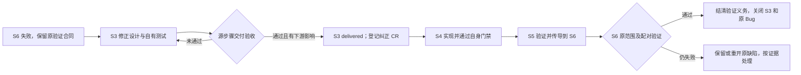

# 上游纠正交付、CR 传导与重试身份修复设计

日期：2026-11-12。编译器基线：`f87b21b`，分支 `feature/0.4.0`。

状态：**设计稿，尚未实施**。用户已澄清：S3 完成本次属于自己的变更后，应结束本次工作，并根据影响决定是否通过 CR 向下游传导；不应为了等待 S4 实现一直停留在 S3。本文据此采用“源步骤交付自己的修正，原失败由纠正链继续验证”的方案。此前提出的“S3 保持 pending”和“默认把 Bug 改派 CODE”均不采用。

本文列出拟修改的合同，不自动替代当前运行规则。实施时须同步修改项目约束、领域约束、调用方和验证。当前进度仍只以 [HANDOVER 状态表](HANDOVER.md) 为准。

2026-11-12 二次设计审查：补齐 pending 源 Bug 的复发处理、无修改纠正的停止条件、传播范围、验证证据生产者、父链交接和幂等边界。第 13 节区分已复现的现行判定缺口与新方案的接入风险。产品代码仍未修改。

## 1. 已确认的问题与边界

### 1.1 门禁、权限和传导不是同一个问题

当前 S3 拥有详细设计、集成基线及同层继承测试的写权限；本次候选已实际修改这些文件。S3 不拥有 S4 的源码，也不拥有 S6 的补充测试。这里没有发现 S3 自有测试的权限漏配。

S3 执行的是自己编写、供 S6 消费的集成基线，不是 S4 的单元测试门禁。然而这些基线会调用当前产品实现。正确的设计和断言可能揭示尚待 S4 修正的产品错误，因此“源步骤自己的产物合格”和“产品已经满足这些断言”不能共用一个没有范围标识的成功结论。

当前阻塞链为：

1. S6 失败，Bug 回到 S3。
2. S3 修正设计/测试，产品实现仍未修正。
3. `resolveBaselineGateExecution` 要求 post-code correction 执行基线；执行失败阻止 `AttemptResult` 成功。
4. `AttemptResultProcessor.process` 只在成功结果上调用纠正传播。
5. `propagateCorrectiveChange`、`prepareSourceChangeRequest` 又要求源步骤已有通过的质量评估；后者还会把源 Bug 转成 `resolved`。
6. 因而无法先建立 S4 的 CR，形成“先实现才能通过、先通过才能传导”的循环。

### 1.2 重试身份错误

`project_controller.ts` 用 `ticket.stepId` 计算当前指纹，`attempt_runner.ts` 用实际执行的 `domainStep` 记录失败指纹。Bug 的前者是发现步骤，后者是修复步骤，身份不一致使全部失败被当作旧上下文。

该问题由 `4a0f1f7`（2026-09-02）引入。用 `BUG-P2-002` 的真实记录执行历史策略：该提交前停止追加，该提交后及当前版本错误放行。交付阻塞的关键策略变化来自 `b67aa71`（2026-08-13）；D-59 后来只对契约变更请求增加了延后执行。

### 1.3 本次业务证据

- `BUG-P2-002`：S6 发现，S3 修复，11/12 次，pending；同一失败签名出现 4 次，额度从 6 延长至 12。
- 业务主线 `2079b26`：原范围重放 32 失败、20 通过。
- 候选 `80ec691`：同一测试路径集合重放 31 失败、19 通过；测试集合已改变，不能以失败数减少证明修复。
- 旧 CLI、P1/P2 同名模块混用属于实现问题；非法标记用例还存在测试职责错误。

上述为调查阶段的只读复现，未代表本设计已获得实施验证。派生工程细节仅作为回归样例，不写入通用 Runtime 规则。

### 1.4 关闭判定的用例范围缺口

用户进一步确认：S6 产生的源 Bug 必须在原 S6 验证通过，不得提前关闭。当前 `bugVerificationSatisfied` 会比较步骤 ID 和类型，但 `selectorCoveredBy` 将要求的选择器和执行选择器均缩为文件路径，无法区分同一文件内的不同用例。

只读纯函数复现：使用真实 Bug 的一个失败选择器构造单用例合同，再传入同文件另一个用例的通过结果；S4 被正确拒绝，S6 上的错误用例却返回满足合同。此复现证明判定函数存在缺口，不表示业务运行中已经发生过提前关闭。须在实现中补齐真实生产者证据及关闭调用链回归。

## 2. 目标与保持的约束

保持 `S6 → S3 → CR → S4 → S5 → S6` 的纠正路径；S1/S8、S2/S7 的同类路径使用同一套规则。

- S3 自己的修改验收通过后可成为 `delivered`，其本次工作结束；配对验证完成后才是 `closed`。
- 根据真实影响决定是否传导。不存在下游变化时不制造 CR；存在未完成的下游实现或原验证义务时不能宣称无影响。
- 不扩大源码、补充测试或继承资产的写权限，不修改原始失败身份和验证契约。
- 不通过提高失败容忍度、清空失败数、删除用例或伪造成功来放行。
- 原 Bug 的关闭仍需指定验证步骤证明原失败范围；S3 交付不能被解释为产品缺陷已经解决。
- 首轮 pre-CODE、已批准的 D-59 contract-change、S4 完整实现门禁、S5–S8 验证、Phase 交付、权限和基础设施处理保持原有边界。
- 本轮处理共同成因，不另建通用流程引擎，不添加针对 DBC/Excel 的产品规则。

### 2.1 处理 owner 与验证责任（2026-11-12 用户确认）

用户选择保留现有分工：**Bug 的处理 owner 在 S3，原 S6 保留发现与最终验收责任，下游 CR 各有处理人。** 本轮不改变现行 Ticket ownership 属于 assigned processor 的定义，也不增加“主 Bug 固定归 S6、另建修复工作票”的职责模型。

| 职责 | S6→S3 纠正中的承担方 |
|---|---|
| Bug 创建者 | S6 的发现 Actor；创建记录保留 |
| 源 Bug 处理 owner | PM 分配给 S3 修复工作的 Actor，沿用现有合法重分配机制 |
| 下游 CR 处理 owner | PM 为各目标步骤分配的 Actor，不替换源 Bug 的处理 owner |
| 最终验证责任 | 原 S6 步骤，由执行该步骤的 Actor 提供原范围验证证据 |
| 关闭状态转换 | 应用／领域流程依据有效证据及全部关闭条件执行 |

S3 完成本次修正并通过自有产物交付验收后，CR 承接下游工作，V 模型按影响继续推进；源 Bug owner 保留不表示 S3 可以越过 S6 关闭该 Bug，也不表示等待期间持续占用 Actor 容量。S1/S8、S2/S7 等路径同样区分处理 owner 与验证责任，实际目标由既有路由和原验证合同确定。

## 3. 两种不同的验收范围

### 3.1 源步骤交付验收

验收的是当前步骤负责的设计、测试资产和纠正要求：

1. 声明的产物完整，变更属于当前写入范围。
2. 修正符合已接受的上游契约；引用绑定到真实版本。
3. 基线测试的语法、结构、产品引用及行为断言有效；当前步骤自己的测试/夹具错误已处理。
4. 继承测试变更具有现有合同要求的依据，不因本次传导放宽保护。
5. 源步骤不存在未完成的自身工作；每项剩余问题有明确下游责任和验证安排。

### 3.2 产品执行验证

记录真实命令、环境、退出码、用例结果、代码/测试版本和原始证据。它证明产品行为，不能用源步骤交付评估替代。

纠正期间可以执行基线诊断；已经获得结论且实现未改变时，不重复运行相同命令消耗轮次。失败是否属于下游实现，需要技术角色的结构化判断和确定性边界检查，不能由异常文本、路径名或 `blockedBy` 自由文本直接决定。

| 当前结果 | 源步骤能否交付 | 后续处理 |
|---|---|---|
| 自有产物或测试有错误 | 否 | 在本步骤修复 |
| 自有修正合格，剩余失败由下游实现造成 | 可以，须同时登记传导和验证义务 | CR 传导，失败事实继续保留 |
| 设计正确、无需文件修改，但实现未遵守设计 | 可以，须证明已检查相关版本 | 形成有证据的纠正要求，不编造设计差异 |
| 当前范围全部通过，确无下游影响 | 按现有完整门禁处理 | 不制造空 CR；原 Bug 仍受原验证契约约束 |
| 所有权不清、混合失败未逐项说明 | 否 | 补充诊断，不默认延后整组失败 |
| 权限拒绝、依赖/服务失败、命令未产出结论 | 不能作为“下游测试失败”放行 | 保持现有权限/环境/依赖控制路径 |

本次应先纠正 S3 自己的测试职责问题，再把真实实现义务交给 S4；不能把测试缺陷和源码缺陷一并当成“下游问题”。

新分支仅用于 S1–S3 的 Bug、Enhancement 及承接它们的纠正型 CR，且确有经审查的下游义务。不能把它作为所有失败的兜底；S4 和验证步骤仍须通过自己的完整门禁。源步骤不改变已接受业务契约，若确需改变，则进入既有契约变更流程。

## 4. 类型与证据设计

### 4.1 有范围的质量评估

拟在质量评估中明确区分现有完整步骤评估与 `source-correction-delivery`（源步骤纠正交付评估）。旧记录保持原含义；不能把历史失败评估重新解释成源步骤通过。

源步骤纠正评估通过只证明第 3.1 节。产品诊断仍引用原始 `TestOutcome` 和审计记录，包括非零失败数，不经 `failedTests=0` 或删除 `gaps` 的方式改写成成功。

`requirePassingQualityAssessment` 等消费入口必须验证“是否通过 + 评估范围 + 步骤 + 产物版本”。除专门的源步骤交付路径外，现有调用者默认要求完整步骤评估，防止较窄评估被用来关闭 Bug、验收 CODE 或通过 Phase 门禁。

### 4.2 有证据的传导提议

扩展已有执行回合/纠正处置的结构化合同，避免增加另一份自由文本协议。技术角色提供：

- 本次自有产物变更及已检查的版本；无修改时说明既有契约如何约束实现。
- 每项未解决失败的证据引用、责任类型、所涉及的下游产物及所需修改。
- 需要经过的下游步骤和原验证步骤；与现有计划、资产归属一致。
- 验证义务：原验证合同引用、失败范围、需要在下游验证的行为；不能缩小原合同。

Runtime 核对工具执行事实、同 Project/Phase、V 顺序、文件归属、证据版本及失败覆盖。PM 记录并路由技术角色已经提出的内容，不创造或改写诊断。未知/遗漏项不自动放行，不根据 prose 选择控制流。

传导证据以头 CR 的类型化载荷及其对象版本为权威，子 CR 引用并携带原始来源。失败细节仍留在原始证据中，避免每个 CR 复制一份可漂移的长日志。

### 4.3 明确的尝试结果

内部结果需要区分：完整门禁通过、源步骤交付且需要继续传导、失败。采用单一判别字段表达，不新增与 `ok` 各自可独立变化的第二份状态。

Executor、Runner、ResultProcessor、Orchestrator、插件事件、模型结果统计和终端展示共同迁移调用点。源步骤交付应显示“本步已交付，纠正链待实现/验证”，不能显示“全部测试通过”或“Bug 已解决”。

“共同迁移”要求逐一核对消费者，不意味着重写所有层的协议。先在已有执行结果和应用命令中增加所需判别；对外字段或事件确需改变时再同步其版本和调用者，不另造一套平行工作流。开始实现前列出每个成功判定的用途：本步完成、产品通过、合并资格、Bug 关闭不能互相代用。

## 5. 状态与流程

| 时点 | S3 | 原 Bug | CR/验证责任 |
|---|---|---|---|
| S3 正在纠正 | in_progress | in_progress | 尚未交付 |
| 本次自有修改通过交付验收 | delivered | pending，等待纠正链 | 已有可恢复的 CR 承接实现/验证义务 |
| S4/S5 工作期间 | delivered | 不因任意下游门禁通过而自动 resolved/closed | 每跳记录自己的修改、门禁和传导 |
| S6 精确复验通过 | 配对闭环后 closed | 走有真实证据的合法终态路径 | 不再遗留实现或原验证义务 |
| S6 失败 | 按责任决定是否再次 reopen | 同一失败继续由原 Bug 负责 | 不能用无关测试通过消除失败 |

本设计不新增全局 Step 状态，也不需要让普通任务绕过 pending 的上游依赖。S3 delivered 表示源步骤产物交付，符合其后仍需配对验证的含义。

原 Bug pending 不再代表“继续安排 S3 重做”：活动 CR 承接后禁止调度源 Bug，释放源 Actor 容量，沿用现有“释放容量不等于删除 accepted assignment”的规则。只有链失败且需要源步骤重新修正时，才重新安排它。本方案首版在原验证之前保持这种有承接关系的等待；不因 S3 交付或 S4 单独通过转为 resolved。合法关闭路径可经过 resolved，但不借中间状态声称尚未完成的产品修复已经结束。

无下游影响的路径还必须检查原验证合同是否已被满足；若原验证尚欠执行，仍需保留可调度的验证责任，不能出现“无文件修改所以没有后续工作”。

### 5.1 原 Bug 的关闭条件（用户明确确认）

S6 产生的 Bug，其 `verificationStepId` 必须保持原 S6 的规范 ID；不能改成 S3/S4/S5，也不能用另一个 Phase 的同类型步骤代替。

关闭必须同时满足：

1. 原 S6 实际执行了对该 Bug 有效的验证，且产生可核验的通过结果。
2. 实际通过范围覆盖原失败范围。一个文件中的用例 B 通过，不能证明同文件用例 A 通过；部分选择、过滤参数和跳过也不能被当作完整文件执行。
3. 验证证据绑定被验证的源码、测试及契约版本；原失败再次出现或相关内容变化后，旧通过记录不能自动关闭当前问题。
4. 原验证合同、交付门禁要求及所有来源的验证义务均已满足；不能只因 CR 已关闭、S3 已交付、S4/S5 已通过或模型声称修好而关闭。

完整文件/目录运行只有在具有可靠的实际执行范围证明时，才可覆盖其内的原失败用例；若现有 `TestOutcome` 的参数和退出码不足以证明，应补充生产者的结构化执行证据。零用例、用例已删除、被过滤或被跳过不能算作通过。

中断恢复可以使用已经持久化且仍有效的 S6 通过证据完成尚未结束的关闭写入，不必为恢复重复调用模型或重跑测试。这仍是“先在 S6 验证通过，后关闭”，不能凭缺少后续失败记录推定通过。

实施时必须补齐证据生产端，不能只修改 `selectorCoveredBy`：

- 当前 `TestOutcome` 仅有步骤类型、参数、状态和失败选择器等信息，没有实际通过用例清单，也没有被测版本绑定。测试工具应输出具有来源的结构化执行范围及结果，Runtime 绑定真实步骤 ID、调用 ID、工作区和被测内容。覆盖 `run_tests` 及识别为测试调用的 `run_program`，不能仅修一个入口。
- 文件级要求要证明应执行的集合完整；用例级要求要证明原用例实际通过。选择参数、配置过滤、参数化用例、跳过、预期失败及零收集不能由总退出码替代。未支持的 runner 缺少证明时明确保留未验证状态，不猜测通过。
- 有效性至少关联本轮纠正、原合同、源码/测试/契约和影响执行的依赖及测试配置。先使用可保守验证的输入快照；不能仅按已知失败文件推断所有相关依赖均未改变。
- 记录保留为追加证据，但同一失败的新判决会使此前成功证据不再能证明当前修复。不能由“存在相同 failureIdentityKey 的任意历史记录”直接判定通过。旧记录字段不足且无法由可信原始记录重建时，需要新的原步骤验证，不能回填虚构版本。
- 原 S6 通过是关闭的必要条件。若该 Bug 尚有活动影响链，仍遵守现行终跳及全部来源验证规则；不能把流程图读成“S6 一通过就忽略剩余义务”。配对 Step 的关闭仍要求其完整门禁通过，不增加“部分用例通过就关闭 Step”的路径。
- 按原验证合同类型校验证据：测试缺陷要求测试范围证明，质量或操作合同要求对应质量门禁或原操作的证明。共享关闭入口不能把所有类型都改成必须存在测试用例，也不能以任意测试通过替代质量/操作合同；源交付评估不充当其中任何一种产品通过证据。

原合同不因测试改名或删除而变更。合法测试修正须保留原行为与可执行验证身份；不能保留身份时，当前方案不自动建立等价映射，须按第 12 节先处理合同边界。保持用例名称本身也不能证明断言未被削弱。

### 5.2 同一故障复发与等待责任

现行 `reopenResolvedForRecurrence` 只查找 resolved Bug，新方案不能原样沿用。只在原指定验证步骤对已承接纠正返回同一结构化失败时，恢复原 Bug 的修复责任；普通 pending、权限等待、重复报告及不同失败不能混为复发。每次判决和当前承接关系须可审计，复发不能重置重试预算。

必须同时处理以下调用点：

1. recurrence 路由识别有完整交接证据的 pending 源 Bug，避免另建 Bug 再按重复报告停放，导致原 Bug 永远等不到判决。
2. 调度从权威 CR 来源和交接关系判断谁承接当前义务，校验源 Ticket 的反向链接；不能只看可能缺失的 `changeRequestTicketIds`。同一义务只能有一个当前可执行承接者，源 Story、源 Bug、旧 CR 不能同时重做。
3. CR 中止、取消或链已结束但原验证尚欠执行时，明确留下修复或验证工作；不能仅因“没有活动 CR”便自动重跑 S3，也不能遗失原 Bug。
4. 无改动停止条件检查本轮整个纠正过程：S3 没有差异但 S4 已修改实现，不等于未修复。当前 `lastChangelistOn(source, targetStep)` 的空变更判断必须调整；整个过程没有有效变化且同构建同失败再次出现时，原有停止保护仍保留，不能靠生成空 CR 延续循环。

## 6. CR、工作区和合并

- 沿用 `changeKind: corrective`；不为了获得 D-59 的延后行为而伪装成 `contract-change`。
- `contractDelta`/纠正要求保留既有契约依据。无修改传导可以没有文件差异，但必须有明确实现要求、已检查的下游文件及证据；不制造虚假的 before/after。
- 根据真实受影响的产物和验证义务计算传播范围。源步骤已改文件、下游待改产物、原验证义务分别保留，计算所需步骤时共同考虑；不能用非空 `changedFiles` 覆盖后两项。现有“仅测试文件则直达配对步骤”的捷径，只能在没有中间实现义务且依赖确实就绪时使用；S4 以前 delivered/closed 不证明本次无需修改。
- S4 在继承的候选修订上工作，携带源文档/测试修正；不从不含该修正的旧主线重新开始。
- 源步骤交付不等于整个候选具备合并资格。仅有源步骤评估时不触发通用自动合并；S4 及后续工作仍走各自现有合并检查。
- 对真正仅需测试修正、可直接进入配对验证的路径，验证工作必须继承包含该修正的候选，之后仍经过现有合并检查；不能把“S4 合并”写成所有路径唯一的候选入口。不能在主线旧文件上验证，再用结果关闭尚未集成的候选。
- 合并、冲突解决或文件改变后，失效的文件级证据必须重新验证；不因提交号改变而无条件丢弃所有证据，也不复用内容已经改变的评估。
- 同源同版本重复提交传导提议复用已登记的头 CR。新提议不得静默替换活动 CR 的内容；需明确的新版本及因果关系。
- 折叠 CR 保留所有 source Ticket 和验证义务。旧父 CR 与新的纠正链汇合时，由真正继续执行的链承接义务；不能借“解除阻塞”把 Bug 提前 resolved。
- 委派是因果关系，不是“子 CR 必须等原 Bug 已解决”的依赖；避免形成等待环。

父链汇合必须逐来源核对。现行 `metRepairedRequest` 使用 `some` 判定汇合、随后处理全部来源；接入新方案时，不能因为一个来源在下一步遇到父 CR，就让其他来源一起停止传播。先证明每个剩余义务都有继续执行的承接者，再结束当前跳。没有合法承接方式时保留未完成状态，不提前标记成功。

父 CR 恢复前应持久化它接收的候选版本和验证义务，只解除阻止该承接者执行的对应阻塞边；保留其他真实阻塞以及原 Bug 未验证状态。下一次调度不得让旧父 CR 的缺失反向链接重新激活源 Bug，也不得把转交当作“原 Bug 已解决”。

## 7. 持久化与中断恢复

`DomainObjectRepository.commit` 最终使用注册表的多行追加，不能仅凭“一个 batch 调用”假设文件系统崩溃时全部对象同时可见。本设计不扩展通用存储事务模型，采用现有对象/事件和幂等应用命令完成可恢复的交接。

1. 先保存候选修订和不可变证据，不能先把源步骤标为已交付。
2. 登记含传导证据的头 CR，但在交接完整前不得调度执行。
3. 持久化有范围的评估、源步骤交付、源 Bug 等待关系、Actor 释放和 trace。
4. 校验所有引用完整、版本一致后，登记交接完成记录并激活 CR。
5. Runtime 恢复时先完成或报告未完成交接，再运行普通调度；不得借恢复扫描补造成功。

交接标识由来源 Ticket、源步骤、验证合同、被审查的产物版本及**当前纠正轮次的持久化因果身份**组成，不依赖摘要文字、临时路径或重试次数。同轮中断恢复复用同一交接；新一轮原验证失败后，即使 S3 文件完全相同，也不能误用上一轮已完成 CR。轮次从已有持久化判决/转换及因果关系确定，不能每次启动生成新身份或新增可独立漂移的计数器。被审查版本还须覆盖提议依赖的下游输入，不能只散列 S3 文件。

交接完成记录必须关联精确的来源、CR、候选和评估版本；完成标记本身不替代引用校验。创建后的 CR 在交接完成前不可执行，源步骤也不能在部分写入窗口被重新派发。`next`、`resume` 和启动时的 reclaim/reconcile 都遵守这一约束；普通“释放循环阻塞”不能先于交接恢复而把未完成的链放行。前缀写入可见、候选提交已经完成、Actor 已释放等中断窗口都必须可重入，且不重新调用已经留存完成的模型请求。

须逐一审查 `prepareSourceChangeRequest`、`awaitVerification`、`reconcileClosedRequestSources`、`releaseCyclicCorrectiveBlockers`、调度 next/resume 和父 CR 汇合处理：只有完成全部验证的证据才支持终态；活动 CR 不能被恢复逻辑误当成无效阻塞。

历史请求按原协议解释，不追加新的处置字段或修改捕获消息。旧的 `done=true`、模型“已完成”文字或失败质量评估不能被追认成新的交付证据。

## 8. 重试身份修复

1. 以本次 `ScheduledWork.step` 为比较对象，并与规范的执行目标解析结果核对；不再使用 Bug 的发现步骤。
2. 统一 Bug、Enhancement、CR 的执行目标解析。注意当前 scheduler 对 CR 另取 `targetStepId`，不能只机械替换为一个尚未统一的 helper。
3. 失败证据记录并比较步骤 ID、构建标识、指令指纹；使用已有日志的 `data.stepId`，不从错误文字推断。
4. 同步骤、同构建、同指令下重复失败沿用现有三次停止策略。构建/指令变化的既有政策不在此轮扩大；恢复、换角色、转交不清零次数。
5. 源步骤有证据的交付不是一次失败。下游 CR 的独立工作不能被归入源步骤的重复失败；同一活动 CR 不因重新启动而获得新的身份和预算。
6. 旧记录缺少身份时，不把“身份未知”解释为“已证明上下文改变”；采用已有可核验字段，无法判断时明确报告。正常的新日志应完整记录身份。

本次不顺带重写所有失败签名算法；以真实记录已经出现的重复签名验证比较对象修复，再独立记录其他签名质量问题。

## 9. 受影响模块与合同

| 层/模块 | 设计要求 |
|---|---|
| 领域质量、交付门禁、Step 合同 | 显式评估范围；S1–S3 源产物交付与产品验证分离；完整验证范围不减小 |
| 执行回合协议/处置解析/Rule 指导 | 结构化传导依据；本步完成与产品完成的区别；中英文及协议版本同步 |
| Executor / attempt_policy / Runner | 不靠清零失败数完成源交付；记录诊断原文；完整失败与源交付使用不同结果路径 |
| ResultProcessor / corrective_workflow_service | 根据影响生成 CR；校验所需评估范围；不自动宣布源 Bug 已修复 |
| ticket_workflow / lifecycle / blockers | 挂起原 Bug、释放容量、维护因果关系；原范围通过才终结 |
| scheduler / project_controller | 统一执行身份；源 Bug 不与活动 CR 竞争；next/resume 同义 |
| Orchestrator / workspace / merge | 区分源交付与合并资格；继承正确候选及内容证据 |
| Registry 恢复、投影、终端和报告 | 未完成交接不参与调度；明确显示源步骤已交付、下游待验证 |

需修改的现行合同：项目约束中“S1–S3 回流必须执行基线”的无条件阻塞含义、`baselineDeliveryGate` 对 post-code 的描述、无范围的质量评估消费、源交付时自动 resolved 的假设。执行、诊断、失败留存仍保留；修改的是何种证据足以完成本步骤，而非篡改测试结果。

编译器维护规范不复制进模型提示。产品提示调整只通过既有 Rule/协议机制进行，且与实现同步版本化。

## 10. 验证与证伪清单

以下为实施验收要求，当前均未执行：

| 场景 | 必须证明的行为 |
|---|---|
| S6→S3→S4→S5→S6 | 源交付后 CR 能执行；S3 无须修改源码；最终原范围通过才能关闭 |
| 源 Bug owner 与各跳 CR owner | 沿用分配关系，原验证步骤不随处理人或 CR 变化；源 owner 无权用自身交付证据替代最终验证 |
| 设计无修改、实现未对齐 | 有证据的纠正要求可传导，不强迫制造文档改动 |
| S3 无改动、S4 已修复、S6 同一故障仍在 | 交回原 Bug；不被 S3 空 changelist 误判为全程无改动；不重置预算 |
| 测试错误与实现错误混合 | 自有测试先修正；其余失败逐项说明，不整组盲目延后 |
| 源步骤只改测试、S4 过去已交付但本轮仍有实现义务 | 传播仍包含 S4，不走仅测试捷径；待改产物不被 changedFiles 覆盖 |
| S1/S8、S2/S7 同类纠正 | 同一规则适用，无样例工程特例 |
| 源文件缺失、测试语法错误、非法路径/修改依据 | 阻止源交付，不能以“下游负责”绕过 |
| 权限拒绝、无结论测试、服务故障 | 保留原分类，不计为可延后的产品失败 |
| 原验证范围之外的测试通过 | 不关闭原 Bug；保留失败范围 |
| 同文件 A 失败、只运行 B 通过 | 拒绝关闭；覆盖判定必须保留用例选择粒度 |
| S4/S5 运行同名测试、另一 Phase 的 S6 通过 | 拒绝替代原 S6 的验证 |
| 历史 S6 已通过、随后同一缺陷复发或相关版本变化 | 旧证据不能自动关闭本次缺陷；有效且未失效的中断恢复证据可以复用 |
| 当前原范围失败，同时存在同身份历史通过记录 | 明确拒绝关闭；不能由历史记录覆盖新失败判决 |
| 通过摘要、过滤/跳过、运行目录或依赖配置改变 | 校验真实运行集合和输入版本；两个测试工具入口一致 |
| 用例删除、改名、跳过、弱化断言 | 不能制造关闭证据；合法测试修正保留契约依据和版本 |
| 多源 CR、父链汇合、末端无后继 | 所有来源均被验证；不遗漏、重复或循环创建工作 |
| 折叠来源只有一部分遇到父 CR | 各来源的候选和验证义务均有明确承接者；不整组提前停止 |
| 评估/候选内容变化、旧回放响应 | 不能将过期或旧协议证据解释为新交付 |
| 每个交接写入边界中断 | 恢复不重复创建 CR、不提前关闭、不泄漏 Actor 容量 |
| 相同 S3 内容的恢复与新一轮纠正 | 恢复复用 CR；有新失败判决的新轮次不误复用旧 CR |
| next/resume、普通 Story 与活动 CR 竞争 | 调度一致；不反复安排已交付的源步骤 |
| 源反向链接缺失、承接 CR 中止、启动恢复释放阻塞 | 不重复派发，不遗失验证责任，不把不完整交接当成可执行工作 |
| 同 Bug 的发现/修复步骤不同 | 重复三次停止；CR 使用自己的当前执行步骤 |
| narrow assessment 被传给 CODE/Phase/关闭入口 | 拒绝错误范围，不能以 passed=true 绕过 |
| 原合同为质量门禁或操作，而非测试用例 | 保留其类型对应的关闭条件；不强塞测试选择器或接受无关测试通过 |
| 候选合并与冲突 | 不合入未具备相应资格的候选；证据绑定最终检查的版本 |
| 真正只改测试且直接进入配对验证 | 验证继承正确候选，具备资格后仍有合并路径，不依赖必须经过 S4 |

需要实际文件、进程和持久化恢复集成测试，不能只靠 mock。分别移除执行目标解析调用、源交付范围检查、CR 链接、恢复完成检查和精确复验检查，确认对应调用链测试失败，再恢复。

框架验证通过后，才在 后续派生验证工程 做业务续跑：真实 CLI 进程、P1/P2 混合回归、改变测试执行顺序、原失败集合和完整阶段门禁。只补 writer 接口或使单元测试通过，不能替代 P2 编排完成的验证。

## 11. 实施顺序与现有工程恢复

| 顺序 | 工作 | 完成条件 |
|---|---|---|
| 1 | 重试身份修复 | 真实记录回归和调度入口证伪通过；独立可审查提交 |
| 2 | 精确复验与历史证据有效性 | 先补真实测试生产者及关闭调用链，修复同文件误覆盖、旧通过覆盖新失败；两个工具入口和证伪通过 |
| 3 | 质量范围与结构化传导合同 | 生产者/消费者完整接线，历史捕获请求不改写；此时不启用源交付新路径 |
| 4 | 源交付、CR 生命周期、工作区与恢复整体接线 | pending 复发、全链无改动保护、传播/父链汇合、候选继承和各写入边界恢复一起验证；完整链通过前不业务续跑 |
| 5 | 完整受影响门禁及文档/Rule 同步 | typecheck、lint、适用 core/integration/e2e、build 和差异审查完成 |
| 6 | 原业务工程恢复与验证 | 在用户右侧 Terminal 继续原工单；保持过程可见 |

现有工程恢复：保留原 Ticket、候选修订、失败次数、原始审计和验证合同；读取 `BUG-P2-002` 最新状态并重新审查候选中的测试修改与重复设计附录。只有通过新交付判定后才创建/复用 CR。不能根据本设计文档直接改状态或追认旧失败尝试成功。

每阶段完成后本地提交；不 push。发布仍放在功能验证之后。

## 12. 风险与实施停止条件

- 若评估范围无法贯穿某个关闭/合并/恢复入口，停止接入该功能，不能用普通 passed 标志代替。
- 若现有 CR 折叠或父链汇合会丢失验证义务，先补齐证据传递和恢复测试，不提前业务续跑。
- 若运行时只能知道整组测试失败，不能虚构逐用例归属；保留整组验证范围，归属不清时诊断仍未完成。
- 若需要改变源码所有权、原验证合同、已交付里程碑或处理新版本之外的旧工作区，返回用户确认，不能顺带迁移。
- 本设计承认 S3 本次产物可交付而产品尚未完成；界面、统计和审计必须同时呈现这两个事实，避免再次把局部完成显示成整体成功。

## 13. 二次设计审查记录

以下“P1”指启用新交付流程前必须处理的风险，“P2”指实现范围或接线需要明确的事项；不是已经发生的业务事故分级。

| 编号 | 优先级 | 风险与证据 | 修订位置 |
|---|---|---|---|
| R1 | P1 | `reopenResolvedForRecurrence` 只识别 resolved；scheduler 用源反向链接排除活动 CR。直接切为 pending 可能重复建 Bug 或重新派发源步骤；属于代码审查确认的接入风险 | 5.2、7 |
| R2 | P1 | 无修改保护只读源 Bug 在修复步骤的最后 changelist。S3 无差异而 S4 真正修改的链，不能按源空变更停止；属于代码审查确认的接入风险 | 5.2 |
| R3 | P1 | 只读函数探针：changedFiles 为测试、处置另含源码义务时，affectedArtifacts 仅保留测试；中间步骤已交付时路由直接返回 S6 | 6 |
| R4 | P1 | 只读函数探针：同文件另一用例通过被判满足原合同；同身份旧通过记录与本次原用例失败同时存在时，`bugVerificationProven` 仍返回 true。现有 TestOutcome 又无实际通过用例清单及内容版本 | 5.1、11 |
| R5 | P1 | 原幂等设计未区分无修改源步骤的新一轮纠正与崩溃恢复；仅按源文件版本会复用错误旧 CR。完成标记、阻塞修复和调度必须有一致读取顺序 | 7 |
| R6 | P1 | 父链汇合按任一来源命中后处理全部来源；pending 等待还会改变原有依靠 resolved 解除阻塞的行为。须逐来源转交义务和候选，不能全局释放 | 6 |
| R7 | P2 | 禁止源评估自动合并后，合法的仅测试纠正可能不经过 S4；方案须明确配对验证继承和后续现有合并路径 | 6 |
| R8 | P2 | 一次性改写所有成功接口会扩大影响面；应以已有执行结果和应用命令为扩展点，核对全部消费者并明确各成功含义 | 4.3 |

三个探针均直接调用当前源码的纯判定函数，没有修改仓库代码、业务工作区或持久化状态；R3/R4 结果只证明局部判定行为，不声称完整 Runtime 已提前关闭实际 Bug。其他条目基于现行调用链与本设计的组合审查，尚需第 10 节的实际集成测试证明。

本次仅修订设计及进度说明，不运行产品回归门禁，不把文档审查或局部探针算作修复完成。核心决定保持不变：源步骤验收其自有产物后结束本次工作，CR 承接下游责任，源 Bug 必须在原验证步骤取得有效证明后才可关闭。
